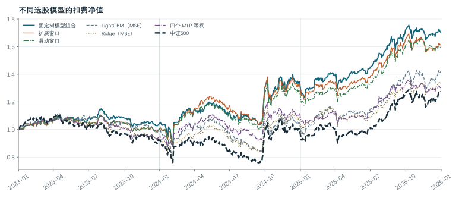

# 中证500日频选股研究：从单因子到前50名排序

本研究比较了两类中证500选股方法：一类用华泰研报中的量价因子分别选股，另一类用 Qlib Alpha158 特征训练回归和排序模型。在相同的交易规则下，LightGBM 与 XGBoost 等权排序组合的扣费收益和夏普率均高于传统单因子、回归基线和本研究中的 MLP 组合。与中证500指数和传统单因子组合相比，它也取得了更小的净值回撤。

## 研究设计

**回测区间为 2023 年 1 月至 2025 年 12 月，基准为中证500价格指数，日线行情来自 TuShare。**

**回测方法。** 每天按历史成分名单确定中证500股票池，T 日收盘打分，T+1 按复权收盘价成交。所有策略共用 Qlib 的 `TopkDropoutStrategy`，目标持有 50 只（`topk=50`），每日计划替换 5 只（`n_drop=5`）。初始资金 1 亿元，买入费率 5 bp、卖出费率 15 bp，每笔最低 5 元。实际回测从 2023-01-03 至 2025-12-31，共 727 个交易日；图中 2026-01 标示区间结束。信号用 T+2 相对 T+1 的复权收盘收益评价，区间内有 725 个交易日能够观察到这项完整的未来 1 日收益。[执行设置与样本覆盖](csi500_research/sources/ml_study/daily_expanding_pair_20261122_133152_853377/execution_audit.json)

**样本划分。** 单因子按已知公式逐日计算，可直接进入测试期回测。2013 年的历史行情用于预热特征，固定模型从 2014-01-02 起训练。两种回归基线用 2014–2020 年训练、2021–2022 年验证。固定排序组合也用 2014–2020 年训练，随后用 2021 年决定每个模型的早停轮数、用 2022 年选择组合参数。两者都在 2023–2025 年测试，训练和验证只纳入收益已在相应区间兑现的样本。逐年重训的模型另按各自窗口划分。[回归实验配置](csi500_research/sources/ml_study/daily_mad_ridge_20261122_145614_730197/config.json) · [扩展窗口日程](expanding_pair_daily.md) · [滑动窗口日程](sliding_pair_daily.md)

## 一、传统单因子选股

华泰证券在《华泰单因子测试之海量技术因子》中检验了 101 个技术因子。本研究从其中选取三个容易解释的量价因子。**Alpha3** 观察过去 10 日开盘价排名与成交量排名的相关性，取负值；**Alpha13** 计算过去 5 日收盘价排名与成交量排名的协方差，再对当天各股的协方差排名并取负值；**Alpha44** 计算过去 5 日复权最高价与成交量排名的相关性，同样取负值。三者都在找价格与成交量走势的差异，但观察的价格和时间窗口各不相同。[华泰原研报，图表 40](https://crm.htsc.com.cn/doc/2019/10750101/dae9cd9e-c2cd-4f05-bb6c-e5ac8d216d3d.pdf) · [本项目因子公式](../../src/factors/price_volume.py)

每个因子先按原公式打分，再做一组行业、市值中性化对照。具体做法是每天把因子值和对数总市值分别限制在截面中位数上下 5 倍 MAD 内，MAD 指各值偏离中位数的绝对距离的中位数。随后用行业虚拟变量和对数总市值解释因子，取每只股票的**实际因子值减去拟合值**，将这份残差在当日截面标准化。遇到无行情、相关系数分母为零或缺少控制变量，保留缺值。[截尾、回归与残差标准化](../../src/factors/neutralization.py)

**表 1　三个单因子处理前后的单日收益预测及扣费回测**　[表格数据（CSV）](csi500_research/tables/table_1_factors.csv)

| 因子 | IC | ICIR | Rank IC | Rank ICIR | 日 Rank IC 标准差 | 累计收益 | 净值最大回撤 |
|---|---:|---:|---:|---:|---:|---:|---:|
| Alpha3 · 原始 | -0.00073 | -0.00968 | **0.00579** | 0.07284 | 0.07943 | 11.48% | -39.47% |
| Alpha3 · 处理后 | **0.00044** | **0.00859** | 0.00569 | **0.10681** | **0.05326** | **27.81%** | **-37.39%** |
| Alpha13 · 原始 | 0.00190 | 0.02405 | **0.02023** | 0.24802 | 0.08155 | **16.68%** | -34.80% |
| Alpha13 · 处理后 | **0.00381** | **0.06930** | 0.01814 | **0.32276** | **0.05621** | 11.36% | **-31.88%** |
| Alpha44 · 原始 | 0.00116 | 0.01470 | 0.01476 | 0.16767 | 0.08806 | **14.54%** | -34.52% |
| Alpha44 · 处理后 | **0.00388** | **0.07242** | **0.01577** | **0.27985** | **0.05635** | 13.87% | **-32.88%** |

表 1 以粗体标出同一因子处理前后的较优值。日 Rank IC 标准差越低，排名关联越稳定。对每个因子单独配对，在原始分数、处理后分数和未来收益都有效的同一批股票日上计算相关性。IC 看分数与收益的线性关系，Rank IC 看两者的排名关系；ICIR 和 Rank ICIR 是各自的日均值除以日样本标准差，均不年化。回测则按每种方法当天实际有效的分数选股。处理后的三条净值及逐日手续费均已与原实验账本核对。[配对 IC 明细](csi500_research/sources/factors/daily_factor_processing_20261122_142859_680463/paired_ic.csv) · [六组回测结果](csi500_research/sources/factors/daily_factor_processing_20261122_142859_680463/portfolio_metrics.csv)

**中性化后，三个因子的 IC 都上升，Rank IC 的变化却有分歧。** Alpha3 与 Alpha13 的 Rank IC 略降，Alpha44 的 Rank IC 略升。三者共同的变化是逐日 Rank IC 的波动明显减小，因而 Rank ICIR 全部提高。以 Alpha13 为例，平均 Rank IC 从 0.02023 降至 0.01814，标准差却从 0.08155 降至 0.05621，稳定性的提高足以抵消均值的下降。

这种稳定性并不保证回测时选取的前 50 只股票赚得更多。处理后三个组合的最大回撤都收窄了，但只有 Alpha3 的累计收益提高，由 11.48% 升至 27.81%。Alpha13 的累计收益由 16.68% 降至 11.36%，Alpha44 也小幅下降。就本样本而言，去除行业、市值暴露对控制回撤的帮助，比它对收益的帮助更一致。

## 二、基于 Qlib Alpha158 的 Ridge（MSE）与 LightGBM（MSE）

**Ridge（MSE）、LightGBM（MSE）和第三节固定组合的八个树排序器共用同一份经过 MAD 截尾的 Alpha158 特征。** 158 列特征来自 K 线形态、价格相对位置、波动和成交量等量价信息。每个信号日，对每一列分别计算当日股票截面的中位数和 MAD，将超出中位数上下 5 倍 MAD 的值截到边界，MAD 为零时保留原值。两种模型都保留原有的行业、市值暴露。两种回归模型在测试期各有 363,222 个预测股票日，股票代码、日期及收益标签逐行一致。[共用特征与 LightGBM 配置](csi500_research/sources/ml_study/daily_alpha158_comparison_20261121_105840_864298/preprocessing_test/sampling_mse/config.json) · [Ridge 同样本实验](csi500_research/sources/ml_study/daily_mad_ridge_20261122_145614_730197/replay.py)

采用这套处理有一个经验依据。对 158 列逐一检验时，做完整的截尾、行业市值中性化和残差标准化后，131 列的绝对 Rank ICIR 提高，但只有 31 列的绝对 Rank IC 提高，平均绝对 Rank IC 由 0.01384 降至 0.01049。单列信号变稳的同时，和次日收益的平均排名关联往往变弱。回归模型会联合使用 158 列，本组实验因此保留这些量价差异，只用 MAD 限制极端值。这一选择的依据是单因子检验，严格分离中性化对模型收益的影响仍需固定其他条件的模型对照。[Alpha158 配对检验](../factors/alpha158_neutral_ic_daily.md) · [逐因子比较数据](csi500_research/sources/factors/daily_alpha158_neutral_20261121_0954/comparison.csv)

完成 MAD 截尾后，岭回归用训练集各列的中位数填补缺失值，再按训练集均值和标准差缩放特征。验证和测试沿用训练集的统计量。LightGBM 直接读取截尾后的特征，在树的分裂过程中自行处理缺失值。[Ridge 模型流程](../../src/ml/models.py)

**Ridge（MSE）与 LightGBM（MSE）均以均方误差评价收益预测。** 两种模型预测每只股票未来 1 日收益在当日股票截面上的标准化值。训练时，将预测值与真实标签之差平方，再对样本取平均，较大的预测误差因此受到更重的惩罚。LightGBM 用验证集 MSE 选择最佳迭代轮数。Ridge 的训练目标在平方误差上加入 L2 正则项（α = 100），验证 MSE 只计算预测误差。

在相同输入下，**Ridge（MSE）的累计收益为 33.26%，LightGBM（MSE）为 42.17%**；年化超额分别为 **1.21% 和 3.65%**。LightGBM 的验证 MSE 较低（0.99668 对 0.99872），但净值最大回撤也更深（−31.29% 对 −29.08%）。[Ridge 验证指标](csi500_research/sources/ml_study/daily_mad_ridge_20261122_145614_730197/ridge_trials.csv) · [Ridge 回测](csi500_research/sources/ml_study/daily_mad_ridge_20261122_145614_730197/portfolio_metrics.csv) · [LightGBM 验证与回测](csi500_research/sources/ml_study/daily_alpha158_comparison_20261121_105840_864298/preprocessing_test/sampling_mse/summary.csv)

也尝试了扩大特征集。在特征集对照实验中，仅用华泰报告中的 101 个因子，双模型累计收益为 **26.30%**；与 Alpha158 合并后为 **34.14%**。相同股票日和相同树参数下，扩充特征没有带来收益优势，后续排序实验沿用了 MAD 版本的 Alpha158。[特征集对照](csi500_research/sources/ml_study/daily_alpha101_ranking_20261121_191330_258749/comparison.csv)

## 三、面向 TopkDropoutStrategy 的股票排序模型

### 排序目标与模型融合

LightGBM、XGBoost 和多层感知机（MLP）各训练四个排序器，分别对应 A、B、C、D 四个选股目标。训练时按每个交易日股票的未来收益排名划分五档（表 2）。对于每天预测的前 50 只股票，A 优先选入真实收益前 50 名，B 优先选入前 100 名，C 尽量避开后 50 名，D 尽量避开后 100 名。三种算法使用相同的分档和增益，以 NDCG@50 评价名单前 50 位的排序质量。

**表 2　四个排序目标的收益分档与增益设置**　[表格数据（CSV）](csi500_research/tables/table_2_ranking_gains.csv)

| 目标 | 后50 | 倒数第51–100 | 中间股票 | 第51–100 | 前50 |
|---|---:|---:|---:|---:|---:|
| A · 优先选前50 | 0 | 1 | 2 | 3 | 9 |
| B · 优先选前100 | 0 | 1 | 2 | 8 | 9 |
| C · 优先避开后50 | 0 | 6 | 7 | 8 | 9 |
| D · 优先避开后100 | 0 | 1 | 7 | 8 | 9 |

**固定树模型组合由八个排序器等权组成**。LightGBM 分别用 LambdaRank 训练 A、B、C、D 四个排序器，XGBoost 分别用 `rank:ndcg` 训练 A、B、C、D 四个排序器。每个交易日，各排序器独立对股票打分，并将分数转换为当日股票池内的排名百分位。一只股票的组合得分就是它在这八份排名中的百分位均值，每个排序器占 12.5%。“固定”指八个排序器在测试期开始前完成训练，随后用同一组模型逐日生成排名。 [增益及组合权重](csi500_research/sources/ml_study/daily_expanding_pair_20261122_133152_853377/config.json)

固定组合用 2014–2020 年数据训练，2021 年数据确定早停轮数，2022 年数据选择超参数，随后在 2023–2025 年测试。选参依据为组合在四个排序目标上的平均验证损失（1 − NDCG@50），最终为 **0.49311**。LightGBM 和 XGBoost 的最大树深分别为 7 和 5，学习率均约为 0.02554，行、列采样率分别为 80% 和 50%。 [归档参数](csi500_research/sources/ml_study/daily_pair_tuning_20261122_100328_550844/winners.json) · [联合调参结果](csi500_research/sources/ml_study/daily_pair_tuning_20261122_100328_550844/comparison.csv)

在早期 LightGBM 四目标实验中，直接等权的累计收益为 64.11%，逻辑回归堆叠为 −4.98%。 [堆叠与等权](csi500_research/sources/ml_study/daily_rank_stack_20261121_160245_719888/nav_comparison_metrics.csv)

### MLP 排序模型

MLP 也与上文一致均采用 **LambdaRank 加权的成对逻辑损失**训练四个 MLP 模型，隐藏层宽度均为 256、512、128、32，分别使用表 2 中 A、B、C、D 的增益设置。设同一天股票 $i$ 的真实收益档位高于股票 $j$，网络给两者的预测分数为 $s_i$ 和 $s_j$。这对股票的损失为 $w_{ij}\log(1+\exp(s_j-s_i))$。如果网络把档位较低的 $j$ 排在前面，惩罚就更大。训练时只比较至少一只位于当前预测前 53 名的股票对，权重随两只股票的档位增益差和名次折扣差调整。 [训练实现](../../src/ml/listfold.py) · [实验配置](csi500_research/sources/ml_study/daily_mlp_lambdarank_20261122_131215_786064/config.json)

LambdaRank 早停和模型比较采用 **1 − NDCG@50**，数值越小表示前 50 名的排序质量越好。四个 MLP 的预测排名等权合并后，验证集上该指标为 0.48566，低于固定树模型组合的 0.49311。测试集上为 0.49103，略高于树模型的 0.48896。 [训练及测试对照](strategy_summary_daily.md)

**同宽度对照。** ListFold-exp 沿用相同的四层网络、训练数据、预处理和随机种子（158）。每个网络均使用 Adam，学习率为 0.001，每批 8 个交易日，训练 1,000 步。ListFold-exp 按每日真实收益从首尾向中间配对，以配对负对数似然选择检查点，本次选中第 200 步。用相同的四组增益重新评分，其验证和测试 1 − NDCG@50 分别为 0.49002 和 0.49148。2023–2025 年，ListFold-exp 单模型扣费累计收益为 **23.07%**，LambdaRank 四模型等权为 **30.26%**，中证500为 **27.30%**。这项比较同时包含训练目标、检查点选择标准及模型集成的差异。 [同宽度排序评价](csi500_research/sources/ml_study/daily_mlp_listfold_20261122_160258_309195/matched_ndcg_summary.csv) · [ListFold-exp 回测](csi500_research/sources/ml_study/daily_mlp_listfold_20261122_160258_309195/portfolio_metrics.csv)

### 前 50 名单的头部命中率与尾部误选率

**表 3　预测前 50 名单中各真实收益组的占比**　[表格数据（CSV）](csi500_research/tables/table_3_top50_hits.csv)

单列 LightGBM 或 XGBoost 时，只对该算法的 A、B、C、D 四份排名取平均，各占 25%。固定组合合并两种算法的八份排名，各占 12.5%。

| 模型或打分方法 | 真实前50 ↑ | 真实前100 ↑ | 真实后50 ↓ | 真实后100 ↓ |
|---|---:|---:|---:|---:|
| LightGBM 四排序器平均 | 8.87% | 20.20% | 7.78% | 17.85% |
| XGBoost  四排序器平均 | 8.94% | 20.17% | 7.83% | 17.56% |
| 固定组合（LightGBM 4 个＋XGBoost 4 个排序器等权） | 8.85% | 20.11% | 7.72% | 17.58% |
| 滚动树模型组合（扩展窗口） | 8.90% | 20.25% | 7.54% | 17.16% |
| 滚动树模型组合（滑动窗口） | 8.51% | 19.72% | 7.16% | 16.66% |
| LightGBM 五分类（前50概率） | 18.86% | 28.38% | 22.64% | 33.47% |
| XGBoost 二值相关性（MAP） | **19.42%** | **28.82%** | 23.72% | 34.42% |
| MLP A · 选前50 | 16.91% | 27.26% | 19.44% | 29.80% |
| MLP B · 选前100 | 15.90% | 26.33% | 18.06% | 28.42% |
| MLP C · 避后50 | 4.99% | 14.31% | 3.75% | 10.58% |
| MLP D · 避后100 | 4.57% | 13.77% | **3.46%** | **10.22%** |
| MLP · ListFold-exp | 9.42% | 20.65% | 8.64% | 18.20% |
| MLP 四模型等权 | 7.50% | 18.59% | 6.52% | 15.61% |

每日在收益标签有效的股票中取预测前 50 名，统计各真实收益组入选数占 50 只的比例，再对 725 个交易日取平均。真实收益并列时按股票代码排序。该指标衡量当日预测名单，实际组合还包含上一交易日留存的持仓。 [树模型预测](csi500_research/sources/ml_study/daily_pair_tuning_20261122_100328_550844/predictions.parquet) · [MLP 命中率](csi500_research/sources/ml_study/daily_mlp_lambdarank_20261122_131215_786064/hits_summary.csv) · [五分类](csi500_research/sources/ml_study/daily_multiclass_pair_blend_20261122_113142_806061/hits_summary.csv) · [MAP](csi500_research/sources/ml_study/daily_xgb_map_top50_20261122_111448_606781/hits_summary.csv)

MLP A、B 的前 50 命中率均超过 15%，后 50 误选率也超过 18%。C、D 将后 50 误选率压至 4% 以下，但前 50 命中率也降至 5% 以下。四者等权后，前 50 命中率为 7.50%，后 50 误选率为 6.52%，累计收益为 30.26%。

LightGBM 五分类和 XGBoost MAP 的前 50 命中率分别为 18.86% 和 19.42%，但两者选入真实后 50 的比例更高，扣费累计收益分别为 −8.20% 和 −8.57%。固定树模型组合的前 50 命中率为 8.85%，后 50 误选率为 7.72%。在另一组权重实验中，A、B 各占 20%，C、D 各占 30%，后 50 误选率为 5.39%，累计收益为 59.16%。 [五分类回测](csi500_research/sources/ml_study/daily_multiclass_pair_blend_20261122_113142_806061/portfolio_metrics.csv) · [MAP 回测](csi500_research/sources/ml_study/daily_ranking_diagnostics_20261122_145657_160125/portfolio_metrics.csv) · [组合权重对照](csi500_research/sources/ml_study/daily_target_weights_20261121_193954_857118/comparison.csv)

### 扩展窗口与滑动窗口

两组滚动组合均沿用固定组合的八个排序器及其等权设置，每年重新训练排序器。扩展窗口从 2014 年起保留全部训练样本，滑动窗口只保留最近八个训练年度。两组沿用相同的排序器超参数和日频交易规则，均用预测年的上一年做早停，现金与持仓跨年接续。

**表 4　两种滚动训练的样本区间、扣费年度收益和名单重合度**　[表格数据（CSV）](csi500_research/tables/table_4_windows.csv)

| 预测年 | 扩展窗口训练年 | 滑动窗口训练年 | 早停年 | 固定组合（LightGBM 4 个＋XGBoost 4 个排序器等权） | 扩展窗口 | 滑动窗口 | 中证500 | 两种窗口前50重合数 |
|---|---|---|---|---:|---:|---:|---:|---:|
| 2023 | 2014–2021 | 2014–2021 | 2022 | **3.25%** | -0.46% | -0.46% | -7.42% | 50.0 |
| 2024 | 2014–2022 | 2015–2022 | 2023 | 27.39% | **30.86%** | 26.04% | 5.46% | 36.9 |
| 2025 | 2014–2023 | 2016–2023 | 2024 | 29.55% | 23.67% | 27.01% | **30.39%** | 36.4 |

表 4 逐年加粗含指数在内的最高收益。2023 年两组训练样本相同，预测名单与收益一致。此后窗口起点分开，2024、2025 年每日前 50 名单平均分别重合 36.9 只和 36.4 只（按全部有效预测排名，同分按股票代码排序）。扩展窗口在 2024 年领先，滑动窗口在 2025 年领先。全期扩展窗口累计收益为 **61.08%**，年化超额收益为 **7.19%**，滑动窗口分别为 **59.35%** 和 **6.79%**。 [滑动窗口回测](sliding_pair_daily.md) · [扩展窗口回测](expanding_pair_daily.md)

## 四、综合回测结果

**表 5　中证500日频选股结果（2023–2025 年）**　[表格数据（CSV）](csi500_research/tables/table_5_performance.csv)

| 策略 | 累计收益 | 绝对年化 | 年化超额 | 年化波动 | 净值最大回撤 | 最大超额回撤 | 夏普率 | 信息比率 | 月胜率 | 年化单边换手（倍） | 手续费（万元） | IC | ICIR | Rank IC | Rank ICIR |
|---|---:|---:|---:|---:|---:|---:|---:|---:|---:|---:|---:|---:|---:|---:|---:|
| [固定组合（LightGBM 4 个＋XGBoost 4 个排序器等权）](csi500_research/sources/ml_study/daily_pair_tuning_20261122_100328_550844/comparison.csv) | **70.41%** | **19.06%** | **9.14%** | 18.98% | -23.07% | **-9.43%** | **1.009** | 1.151 | 61.1% | 19.37 | 1,459.7 | 0.0163 | 0.160 | 0.0308 | 0.264 |
| [LightGBM 四模型](csi500_research/sources/ml_study/daily_pair_tuning_20261122_100328_550844/comparison.csv) | 69.46% | 18.85% | 9.05% | 19.45% | -22.33% | -10.43% | 0.978 | **1.208** | **63.9%** | 19.21 | 1,435.2 | 0.0156 | 0.158 | 0.0287 | 0.254 |
| [XGBoost 四模型](csi500_research/sources/ml_study/daily_pair_tuning_20261122_100328_550844/comparison.csv) | 66.32% | 18.12% | 8.34% | 18.95% | -23.67% | -10.35% | 0.969 | 1.013 | 55.6% | 19.39 | 1,424.3 | 0.0160 | 0.156 | 0.0312 | 0.267 |
| [滚动树模型组合（扩展窗口）](csi500_research/sources/ml_study/daily_expanding_pair_20261122_133152_853377/comparison.csv) | 61.08% | 16.89% | 7.19% | 18.45% | -20.44% | -11.20% | 0.934 | 0.851 | 55.6% | 23.48 | 1,740.0 | 0.0163 | 0.154 | 0.0302 | 0.248 |
| [滚动树模型组合（滑动窗口）](csi500_research/sources/ml_study/daily_sliding_pair_20261122_150725_707868/comparison.csv) | 59.35% | 16.48% | 6.79% | 18.17% | **-20.26%** | -10.13% | 0.926 | 0.793 | 58.3% | 23.49 | 1,709.1 | 0.0175 | **0.161** | **0.0336** | 0.269 |
| [LightGBM（MSE）](csi500_research/sources/ml_study/daily_xgboost_tuned_20261121_172019_402981/nav_comparison/metrics.csv) | 42.17% | 12.21% | 3.65% | 21.23% | -31.29% | -14.12% | 0.646 | 0.526 | 63.9% | 23.38 | 1,538.4 | **0.0177** | 0.150 | 0.0134 | 0.110 |
| [MLP · ListFold-exp](csi500_research/sources/ml_study/daily_mlp_listfold_20261122_160258_309195/portfolio_metrics.csv) | 23.07% | 7.03% | -1.85% | 17.19% | -26.11% | -22.02% | 0.480 | -0.191 | 50.0% | 23.54 | 1,498.1 | 0.0108 | 0.079 | 0.0319 | 0.224 |
| [MLP 四模型等权](csi500_research/sources/ml_study/daily_mlp_lambdarank_20261122_131215_786064/portfolio_metrics.csv) | 30.26% | 9.04% | -0.08% | **16.67%** | -20.53% | -21.54% | 0.601 | -0.008 | 52.8% | 23.43 | 1,541.7 | 0.0105 | 0.102 | 0.0262 | 0.220 |
| [Ridge（MSE）](csi500_research/sources/ml_study/daily_mad_ridge_20261122_145614_730197/portfolio_metrics.csv) | 33.26% | 9.86% | 1.21% | 19.63% | -29.08% | -12.62% | 0.573 | 0.164 | 47.2% | 23.32 | 1,497.7 | 0.0155 | 0.143 | 0.0199 | 0.174 |
| [Alpha3](csi500_research/sources/ml_study/daily_20261121_092926_223980/portfolio_metrics.csv) | 27.81% | 8.37% | 0.14% | 21.10% | -37.39% | -11.51% | 0.484 | 0.027 | 50.0% | 23.44 | 1,409.4 | 0.0004 | 0.008 | 0.0057 | 0.107 |
| [Alpha13](csi500_research/sources/ml_study/daily_20261121_092926_223980/portfolio_metrics.csv) | 11.36% | 3.59% | -4.37% | 21.13% | -31.88% | -22.45% | 0.272 | -0.889 | 58.3% | 23.49 | 1,409.6 | 0.0038 | 0.069 | 0.0181 | **0.323** |
| [Alpha44](csi500_research/sources/ml_study/daily_20261121_092926_223980/portfolio_metrics.csv) | 13.87% | 4.34% | -3.77% | 20.48% | -32.88% | -14.52% | 0.309 | -0.763 | 52.8% | **18.98** | **1,112.5** | 0.0039 | 0.072 | 0.0158 | 0.280 |
| [中证500价格指数](csi500_research/sources/ml_study/daily_20261121_092926_223980/portfolio_metrics.csv) | 27.30% | 8.22% | 0.00% | 21.07% | -31.15% | 0.00% | 0.479 | — | 41.7% | — | — | — | — | — | — |

表 5 中，点击策略名称可查看实验结果。每列仅加粗一个最优策略，按原始精度比较，同值时标出表中靠前者。波动、换手和手续费取低值，两项回撤取最接近零者，其余指标取高值。指数作为基准单列。累计收益和绝对年化按扣费日收益复利；年化超额等于日均扣费超额收益乘以 238，信息比率和最大超额回撤使用同一日超额序列。月胜率指月度绝对收益为正的月份占比。

正式固定组合按 2022 年验证损失选定，LightGBM 与 XGBoost 各占一半，取得 **70.41% 的扣费累计收益、19.06% 的绝对年化收益和 9.14% 的年化超额收益**。相对同期上涨 27.30% 的中证500，正式组合的累计收益高出 43.10 个百分点，净值最大回撤也从指数的 −31.15% 收窄至 −23.07%。[固定组合的验证与回测结果](csi500_research/sources/ml_study/daily_pair_tuning_20261122_100328_550844/comparison.csv)

不同目标对应的优胜者也有差异。正式组合的夏普率最高（**1.009**），说明单位组合波动对应的收益最高；LightGBM 四模型的信息比率最高（**1.208**），即每承担一份相对指数的波动，赚到的超额收益最多。与三个中性化单因子相比，正式组合在收益、夏普率和净值最大回撤上都占优，但 Alpha13 和 Alpha44 的 Rank ICIR 更高。全市场的排序稳定性与前 50 持仓的收益，值得分开看。

### 净值与累计收益

**图 1　模型组合与中证500的净值。** 各条线从 1 开始，以 727 个交易日的日收益复利计算，均为日频、起始偏移 0。两种滚动树模型的曲线在 2023 年重合。黑色粗虚线为中证500价格指数。每投入 1 元，固定树模型期末约为 1.704 元，指数约为 1.273 元。 [图 1 逐日净值（CSV）](csi500_research/figures/figure_1_model_nav.csv)

**图 2　固定树模型、三个处理后的单因子与指数的累计收益。** 上图从 0% 开始，以净值减一呈现绝对累计收益；下图逐日累加扣费日收益与指数日收益之差。两幅均为日频、起始偏移 0，包含首日指数涨跌。固定组合累计超额在 2025 年 6 月 3 日达到 37.34%，期末回落至 27.91%。 [图 2 逐日累计收益与超额收益（CSV）](csi500_research/figures/figure_2_factor_returns.csv)

## 总结

从三个量价因子出发，行业和市值中性化让信号的日间表现更稳定，也收窄了单因子组合的回撤；收益的改善主要体现在 Alpha3。把 158 个特征用于收益回归后，LightGBM 已能超过指数。进一步让模型直接学习前 50 名的顺序，同时兼顾“选中赢家”和“避开输家”，取得了本研究中最有竞争力的一组结果。

其中，按验证集确定的 LightGBM 与 XGBoost 等权组合，三年年化收益 **19.06%**，年化超额 **9.14%**，信息比率 **1.151**。最大的年度优势来自 2024 年，当年组合上涨 27.39%，指数上涨 5.46%；2025 年组合虽上涨 29.55%，仍略落后于指数的 30.39%。这三年已用于多轮模型比较，部分早期实验也经过筛选。当前成果是同一段历史、同一套交易规则下的可复核对照，后续新增行情才能检验优势是否延续。
