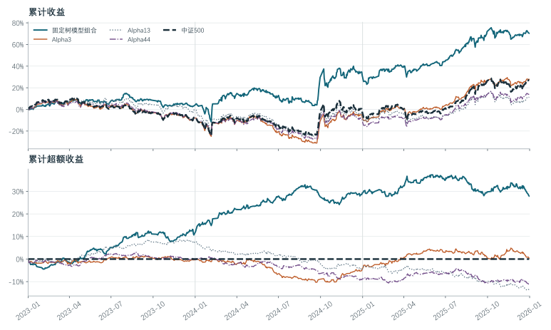

# 中证500日频选股研究：从单因子到前50名排序

本研究比较了两类中证500选股方法：一类用华泰研报中的量价因子分别选股，另一类用 Qlib Alpha158 特征训练回归和排序模型。在相同的交易规则下，LightGBM 与 XGBoost 等权排序组合的扣费收益和夏普率均高于传统单因子、回归基线和本研究中的 MLP 组合。与中证500指数和传统单因子组合相比，它也取得了更小的净值回撤。

## 研究设计

**回测区间为 2023 年 1 月至 2025 年 12 月，基准为中证500价格指数，日线行情来自 TuShare。**

**回测方法。** 每天按历史成分名单确定中证500股票池，T 日收盘打分，T+1 按复权收盘价成交。所有策略共用 Qlib 的 `TopkDropoutStrategy`，目标持有 50 只（`topk=50`），每日计划替换 5 只（`n_drop=5`）。初始资金 1 亿元，买入费率 5 bp、卖出费率 15 bp，每笔最低 5 元。实际回测从 2023-01-03 至 2025-12-31，共 727 个交易日；图中 2026-01 标示区间结束。

信号用 T+2 相对 T+1 的复权收盘收益评价，区间内有 725 个交易日能够观察到这项完整的未来 1 日收益。[执行设置与样本覆盖](csi500_research/sources/ml_study/daily_expanding_pair_20261122_133152_853377/execution_audit.json)

**样本划分。** 单因子按已知公式逐日计算，可直接进入测试期回测。2013 年的历史行情用于预热特征，固定模型从 2014-01-02 起训练。两种回归基线用 2014–2020 年训练、2021–2022 年验证。固定排序组合也用 2014–2020 年训练，随后用 2021 年决定每个模型的早停轮数、用 2022 年选择组合参数。两者都在 2023–2025 年测试，训练和验证只纳入收益已在相应区间兑现的样本。逐年重训的模型另按各自窗口划分。[回归实验配置](csi500_research/sources/ml_study/daily_mad_ridge_20261122_145614_730197/config.json)

## 一、传统单因子选股

华泰证券在《华泰单因子测试之海量技术因子》中检验了 101 个技术因子。本研究从其中选取三个容易解释的量价因子。**Alpha3** 观察过去 10 日开盘价排名与成交量排名的相关性，取负值；**Alpha13** 计算过去 5 日收盘价排名与成交量排名的协方差，再对当天各股的协方差排名并取负值；**Alpha44** 计算过去 5 日复权最高价与成交量排名的相关性，同样取负值。三者都在找价格与成交量走势的差异，但观察的价格和时间窗口各不相同。[华泰原研报，图表 40](https://crm.htsc.com.cn/doc/2019/10750101/dae9cd9e-c2cd-4f05-bb6c-e5ac8d216d3d.pdf) · [本项目因子公式](../../src/factors/price_volume.py)

### 预处理

每个因子先按原公式打分，再做一组行业、市值中性化对照。具体做法是每天把因子值和对数总市值分别限制在截面中位数上下 5 倍 MAD 内，MAD 指各值偏离中位数的绝对距离的中位数。随后用行业虚拟变量和对数总市值解释因子，取每只股票的**实际因子值减去拟合值**，将这份残差在当日截面标准化。遇到无行情、相关系数分母为零或缺少控制变量，保留缺值。[截尾、回归与残差标准化](../../src/factors/neutralization.py)

### 单因子回测结果

**表 1　三个单因子处理前后的单日收益预测及扣费回测**　[表格数据（CSV）](csi500_research/tables/table_1_factors.csv)

| 因子 | IC | ICIR | Rank IC | Rank ICIR | 日 Rank IC 标准差 | 累计收益 | 净值最大回撤 |
|---|---:|---:|---:|---:|---:|---:|---:|
| Alpha3 · 原始 | -0.00073 | -0.00968 | **0.00579** | 0.07284 | 0.07943 | 11.48% | -39.47% |
| Alpha3 · 处理后 | **0.00044** | **0.00859** | 0.00569 | **0.10681** | **0.05326** | **27.81%** | **-37.39%** |
| Alpha13 · 原始 | 0.00190 | 0.02405 | **0.02023** | 0.24802 | 0.08155 | **16.68%** | -34.80% |
| Alpha13 · 处理后 | **0.00381** | **0.06930** | 0.01814 | **0.32276** | **0.05621** | 11.36% | **-31.88%** |
| Alpha44 · 原始 | 0.00116 | 0.01470 | 0.01476 | 0.16767 | 0.08806 | **14.54%** | -34.52% |
| Alpha44 · 处理后 | **0.00388** | **0.07242** | **0.01577** | **0.27985** | **0.05635** | 13.87% | **-32.88%** |

表 1 以粗体标出同一因子处理前后的较优值。日 Rank IC 标准差越低，排名关联越稳定。对每个因子单独配对，在原始分数、处理后分数和未来收益都有效的同一批股票日上计算相关性。IC 看分数与收益的线性关系，Rank IC 看两者的排名关系；ICIR 和 Rank ICIR 是各自的日均值除以日样本标准差，均不年化。

回测则按每种方法当天实际有效的分数选股。处理后的三条净值及逐日手续费均已与原实验账本核对。[配对 IC 明细](csi500_research/sources/factors/daily_factor_processing_20261122_142859_680463/paired_ic.csv) · [六组回测结果](csi500_research/sources/factors/daily_factor_processing_20261122_142859_680463/portfolio_metrics.csv)

**中性化后，三个因子的 IC 都上升，Rank IC 的变化却有分歧。** Alpha3 与 Alpha13 的 Rank IC 略降，Alpha44 的 Rank IC 略升。三者共同的变化是逐日 Rank IC 的波动明显减小，因而 Rank ICIR 全部提高。以 Alpha13 为例，平均 Rank IC 从 0.02023 降至 0.01814，标准差却从 0.08155 降至 0.05621，稳定性的提高足以抵消均值的下降。

这种稳定性并不保证回测时选取的前 50 只股票赚得更多。处理后三个组合的最大回撤都收窄了，但只有 Alpha3 的累计收益提高，由 11.48% 升至 27.81%。Alpha13 的累计收益由 16.68% 降至 11.36%，Alpha44 也小幅下降。

## 二、基于 Qlib Alpha158 的 Ridge 与 LightGBM

接着，本项目采用岭回归和 lightGBM，分别以 Qlib 中提供的 Alpha158 因子作为特征列，以一日后的未来收益率作为标签进行训练。

两种回归模型在测试期各有 363,222 个预测股票日，股票代码、日期及收益标签逐行一致。[共用特征与 LightGBM 配置](csi500_research/sources/ml_study/daily_alpha158_comparison_20261121_105840_864298/preprocessing_test/sampling_mse/config.json) · [Ridge 同样本实验](csi500_research/sources/ml_study/daily_mad_ridge_20261122_145614_730197/replay.py)

### 预处理

对输入的 Alpha158 因子，对其进行 MAD 截断，选择了超过中位数上下 5 倍 MAD 的值截到边界， MAD 为 0 时保留原值。

输入特征预处理时，之所以只采用 MAD 截断而不采用中性化，是因为对 158 列因子逐一检验时，做完整的截尾、行业市值中性化和残差标准化后，131 列的绝对 Rank ICIR 提高，但只有 31 列的绝对 Rank IC 提高，平均绝对 Rank IC 由 0.01384 降至 0.01049。在减小单列信号波动的同时，和次日收益的平均排名关联却也变弱了。因此研究中为了尽可能保留原始因子中的潜在预测信息，同时降低异常值干扰，只选择采取 MAD 截断。[Alpha158 配对检验](../factors/alpha158_neutral_ic_daily.md) · [逐因子比较数据](csi500_research/sources/factors/daily_alpha158_neutral_20261121_0954/comparison.csv)

岭回归额外对输入特征做了更多预处理，包括对输入缺失使用中位数填充，填充完后做 Z-score 标准化等，以使得 158 个因子保持在相同尺度。而 lightGBM 则不再做额外处理，因为其在树的分裂过程中会自行处理缺失值。[Ridge 模型流程](../../src/ml/models.py)。

标签采用 Z-score 预处理以标准化，这一步参考了Qlib处理。

### 训练与调优

Ridge 和 LightGBM 均用 2014–2020 年的数据拟合模型，预测标准化后的未来 1 日收益。Ridge 的训练目标在平方误差上加入 L2 正则项（α = 100），验证时用 MSE 衡量预测误差。

**LightGBM 的早停和超参数选择共用 2021–2022 年验证集。** 本次仅对两个采样参数做简要调优。特征采样比例取 50% 或 70%，样本采样比例取 80% 或 100%。学习率、树深等其余超参数沿用基线设置。每组参数按验证 MSE 早停，连续 50 轮未改善即停止，并保留验证 MSE 最低的轮次；随后按各组最佳轮次的验证 MSE 选择采样参数。

表 2 沿用选出的 Trial 4：特征采样 50%、样本采样 80%，最佳轮次为第 138 轮，验证 MSE 为 0.99668。确定参数和轮次后，用冻结模型在 2023–2025 年逐日打分并回测。[调参配置](csi500_research/sources/ml_study/daily_alpha158_comparison_20261121_105840_864298/preprocessing_test/sampling_mse/config.json) · [入选模型记录](csi500_research/sources/ml_study/daily_alpha158_comparison_20261121_105840_864298/preprocessing_test/sampling_mse/summary.csv)

### 回测结果

**表 2　回归模型的验证误差、单日收益预测及扣费回测**　[表格数据（CSV）](csi500_research/tables/table_2_regression.csv)

| 模型 | 验证 MSE | IC | ICIR | Rank IC | Rank ICIR | 日 Rank IC 标准差 | 累计收益 | 年化超额 | 净值最大回撤 |
|---|---:|---:|---:|---:|---:|---:|---:|---:|---:|
| Ridge | 0.99872 | 0.01551 | 0.14279 | **0.01985** | **0.17439** | **0.11385** | 33.26% | 1.21% | **-29.08%** |
| LightGBM | **0.99668** | **0.01768** | **0.15000** | 0.01341 | 0.10966 | 0.12232 | **42.17%** | **3.65%** | -31.29% |

验证 MSE 取自 2021–2022 年，其余指标取自 2023–2025 年测试期。LightGBM 的扣费累计收益比 Ridge 高 8.91 个百分点，年化超额收益高 2.44 个百分点。Ridge 的 Rank IC 和 Rank ICIR 更高，最大回撤也浅 2.22 个百分点。[Ridge 验证指标](csi500_research/sources/ml_study/daily_mad_ridge_20261122_145614_730197/ridge_trials.csv) · [Ridge 回测](csi500_research/sources/ml_study/daily_mad_ridge_20261122_145614_730197/portfolio_metrics.csv) · [LightGBM 验证与回测](csi500_research/sources/ml_study/daily_alpha158_comparison_20261121_105840_864298/preprocessing_test/sampling_mse/summary.csv)

## 三、针对 TopkDropoutStrategy 回测策略的股票排序模型

本节沿用历史中证500股票池，把预测任务改为每天为股票排序。主策略用四个 LightGBM 和四个 XGBoost 排序器给每只股票打分，另用四个多层感知机（MLP）排序器作对照。每种算法都分别学习 A、B、C、D 四个目标：A、B 优先选入未来收益排名前 50、前 100 的股票，C、D 优先避开后 50、后 100 的股票，详细设置将在后续说明。

每天收盘后，先把每个排序器的分数转换为当日截面排名百分位，再等权平均。对于树模型，分别对只用 lightGBM ，只用 XGBoost 和融合使用 lightGBM 与 XGBoost 分别进行了训练与测试。前两种情况下，每个排序器输出的结果占 25% 并加权，最后一种情况下每个排序器输出占 12.5% ，即都采用排序器等权融合，MLP 排序器类似。测试集根据融合分数决定买卖顺序。T+1 收盘按 Top50/Drop5 成交，实际持仓随每日调仓连续更新。[增益及组合权重](csi500_research/sources/ml_study/daily_expanding_pair_20261122_133152_853377/config.json)

### 预处理

**输入特征。** 三种算法共用第二节的 Alpha158 特征，每个交易日按历史成分股截面对各列做 5 倍 MAD 截尾。树模型直接读取截尾后的特征并处理缺失值。MLP 额外用训练集各列的中位数填补缺失值，按训练集的最小值、最大值截断并缩放至 [0, 1]；早停、验证和测试都沿用这组统计量。[MLP 预处理配置](csi500_research/sources/ml_study/daily_mlp_lambdarank_20261122_131215_786064/config.json)

**排序标签。** 对 T 日信号，计算每只股票从 T+1 收盘至 T+2 收盘的复权收益，在同日有有效收益的股票中排名并划分五档。A、B、C、D 共用这五档标签，分别采用表 3 的增益。具体而言，A 将真实前 50 名的增益设为 9、前 51–100 名设为 3，使模型更重视前 50 名。训练、早停和验证只使用收益终点已落在相应区间内的样本。

**表 3　四个排序目标的收益分档与增益设置**　[表格数据（CSV）](csi500_research/tables/table_2_ranking_gains.csv)

| 目标 | 后50 | 倒数第51–100 | 中间股票 | 第51–100 | 前50 |
|---|---:|---:|---:|---:|---:|
| A · 优先选前50 | 0 | 1 | 2 | 3 | 9 |
| B · 优先选前100 | 0 | 1 | 2 | 8 | 9 |
| C · 优先避开后50 | 0 | 6 | 7 | 8 | 9 |
| D · 优先避开后100 | 0 | 1 | 7 | 8 | 9 |

### 训练与调优

**固定树模型的训练与选参分四步。**

1. **2014–2020 年训练。** 每条样本是一只股票在一个交易日的 158 个因子值，标签是它的下一期收益在当天股票池中所属的档位。模型给每只股票输出一个排序分数，训练时比较同一天的股票。LightGBM 用 LambdaRank，XGBoost 用 `rank:ndcg`。两种算法都按表 3 的 A/B/C/D 增益各训练四个排序器。例如，同样是把一只真实前 50 的股票排得太低，A 会比 C 更重视这个错误。四个 LightGBM 共用一套树超参数，四个 XGBoost 共用另一套。
2. **2021 年早停，决定每个排序器用多少轮。** 给定一套候选参数，每个排序器最多训练 1,000 轮。每轮观察它在 2021 年的 NDCG@50，即预测前 50 名的排序质量，越高越好。连续 50 轮没有改善就停止，保留得分最高的轮数。因此，即使四个 LightGBM 共用相同的最大树深，各自最终使用的树数也可以不同。
3. **2022 年调参，决定两种算法各用哪套树参数。** 对每组候选参数，先把八个排序器的预测分别转换为当日排名百分位，各占 12.5%，得到每天的一份股票名单。再按 A/B/C/D 四套增益分别评价这份名单，对四个目标和 240 个有效交易日的 `1 − NDCG@50` 取平均，损失越低越好。这里做了简要的分阶段网格搜索，依次比较树深、叶子数、叶节点约束、L1、L2、行采样和列采样。每一步保留当前最优组合，再比较下一项。树深阶段共比较 9 种组合，LightGBM 最大深度由 5 调至 7，XGBoost 保持 5，验证损失由 0.49465 降至 **0.49311**。其余六步均保留原值。两种算法的学习率固定为约 0.02554，最终行、列采样率分别为 80% 和 50%。[分阶段选参记录](../../results/ml_study/daily_pair_tuning_20261122_100328_550844/stages.csv) · [最终参数](csi500_research/sources/ml_study/daily_pair_tuning_20261122_100328_550844/winners.json)
4. **2023–2025 年固定模型回测。** 冻结选出的八个排序器，每天收盘后给当日成分股打分。分别取四个 LightGBM 的平均排名百分位、四个 XGBoost 的平均排名百分位，以及全部八个排序器的平均排名百分位，得到三份独立名单。每份名单各跑一次相同的 Top50/Drop5 回测，测试期收益只用于评价。

**MLP 对照。** 每个网络读入单只股票当天的 158 个因子，经过宽度为 256、512、128、32 的四个隐藏层，输出一个分数。四个网络各负责一个排序目标。训练时在同一天取股票对，若真实档位较高的股票得分偏低，就按 LambdaRank 权重计入损失。至少一只股票进入当前预测前 53 名的股票对参与比较。四个网络沿用固定参数，均用 Adam、学习率 0.001，每批取 8 个交易日，训练 1,000 步。每 100 步在 2021 年评估一次，各自保留 `1 − NDCG@50` 最低的检查点。2022 年评估四模型等权后的排序质量，2023–2025 年用同一融合方式回测。[MLP 实验配置](csi500_research/sources/ml_study/daily_mlp_lambdarank_20261122_131215_786064/config.json)

**滚动重训对照。** 树深、学习率等沿用固定组合在 2022 年选出的值。每个预测年开始前，用更新后的历史样本从头训练八个排序器，并用预测年的上一年重新选择各自的迭代轮数。例如预测 **2024 年**时，扩展窗口用 **2014–2022 年**训练，滑动窗口用 **2015–2022 年**训练，两组都用 **2023 年**早停，再对 2024 年逐日打分。下一年，扩展窗口保留 2014 年起的全部历史，滑动窗口始终保留最近八个训练年度。更换模型时，模拟账户的现金与持仓跨年接续。[各年训练与早停区间](csi500_research/tables/table_4_windows.csv)

### 回测结果

**表 4　预测前 50 名单中各真实收益组的占比**　[表格数据（CSV）](csi500_research/tables/table_3_top50_hits.csv)

| 模型或打分方法 | 真实前50 ↑ | 真实前100 ↑ | 真实后50 ↓ | 真实后100 ↓ |
|---|---:|---:|---:|---:|
| LightGBM 四排序器平均 | 8.87% | 20.20% | 7.78% | 17.85% |
| XGBoost  四排序器平均 | 8.94% | 20.17% | 7.83% | 17.56% |
| LightGBM 4 个＋XGBoost 4 个排序器等权 | 8.85% | 20.11% | 7.72% | 17.58% |
| 滚动树模型组合（扩展窗口） | 8.90% | 20.25% | 7.54% | 17.16% |
| 滚动树模型组合（滑动窗口） | 8.51% | 19.72% | 7.16% | 16.66% |
| MLP 四模型等权 | 7.50% | 18.59% | 6.52% | 15.61% |

表 4 按日统计预测前 50 只股票中各真实收益组的占比，再对 725 个交易日取平均。同收益按股票代码排序。固定八模型选入真实前 50 的比例为 8.85%，选入真实后 50 的比例为 7.72%。MLP 四模型对应为 7.50% 和 6.52%，选中两端股票的比例都更低。[树模型预测](csi500_research/sources/ml_study/daily_pair_tuning_20261122_100328_550844/predictions.parquet) · [MLP 命中率](csi500_research/sources/ml_study/daily_mlp_lambdarank_20261122_131215_786064/hits_summary.csv)

实际组合每天最多替换 5 只股票，许多持仓从上一日延续。按这一规则回测，2023–2025 年固定八模型的扣费累计收益为 **70.41%**，单用 LightGBM 为 **69.46%**，单用 XGBoost 为 **66.32%**，MLP 四模型为 **30.26%**，同期中证500上涨 **27.30%**。[树模型回测](csi500_research/sources/ml_study/daily_pair_tuning_20261122_100328_550844/comparison.csv) · [MLP 回测](csi500_research/sources/ml_study/daily_mlp_lambdarank_20261122_131215_786064/portfolio_metrics.csv)

**表 5　两种滚动训练的样本区间、扣费年度收益和名单重合度**　[表格数据（CSV）](csi500_research/tables/table_4_windows.csv)

| 预测年 | 扩展窗口训练年 | 滑动窗口训练年 | 早停年 | 固定组合（LightGBM 4 个＋XGBoost 4 个排序器等权） | 扩展窗口 | 滑动窗口 | 中证500 | 两种窗口前50重合数 |
|---|---|---|---|---:|---:|---:|---:|---:|
| 2023 | 2014–2021 | 2014–2021 | 2022 | **3.25%** | -0.46% | -0.46% | -7.42% | 50.0 |
| 2024 | 2014–2022 | 2015–2022 | 2023 | 27.39% | **30.86%** | 26.04% | 5.46% | 36.9 |
| 2025 | 2014–2023 | 2016–2023 | 2024 | 29.55% | 23.67% | 27.01% | **30.39%** | 36.4 |

表 5 逐年加粗含指数在内的最高收益。2023 年两组训练样本相同，预测名单与收益一致。此后窗口起点分开，2024、2025 年每日前 50 名单平均分别重合 36.9 只和 36.4 只（按全部有效预测排名，同分按股票代码排序）。扩展窗口在 2024 年领先，滑动窗口在 2025 年领先。全期扩展窗口累计收益为 **61.08%**，年化超额收益为 **7.19%**，滑动窗口分别为 **59.35%** 和 **6.79%**。

## 四、综合回测结果

**表 6　中证500日频选股结果（2023–2025 年）**　[表格数据（CSV）](csi500_research/tables/table_5_performance.csv)

| 策略 | 累计收益 | 绝对年化 | 年化超额 | 年化波动 | 净值最大回撤 | 最大超额回撤 | 夏普率 | 信息比率 | 月胜率 | 年化单边换手（倍） | 手续费（万元） | IC | ICIR | Rank IC | Rank ICIR |
|---|---:|---:|---:|---:|---:|---:|---:|---:|---:|---:|---:|---:|---:|---:|---:|
| [固定组合（LightGBM 4 个＋XGBoost 4 个排序器等权）](csi500_research/sources/ml_study/daily_pair_tuning_20261122_100328_550844/comparison.csv) | **70.41%** | **19.06%** | **9.14%** | 18.98% | -23.07% | **-9.43%** | **1.009** | 1.151 | 61.1% | 19.37 | 1,459.7 | 0.0163 | 0.160 | 0.0308 | 0.264 |
| [LightGBM 四模型](csi500_research/sources/ml_study/daily_pair_tuning_20261122_100328_550844/comparison.csv) | 69.46% | 18.85% | 9.05% | 19.45% | -22.33% | -10.43% | 0.978 | **1.208** | **63.9%** | 19.21 | 1,435.2 | 0.0156 | 0.158 | 0.0287 | 0.254 |
| [XGBoost 四模型](csi500_research/sources/ml_study/daily_pair_tuning_20261122_100328_550844/comparison.csv) | 66.32% | 18.12% | 8.34% | 18.95% | -23.67% | -10.35% | 0.969 | 1.013 | 55.6% | 19.39 | 1,424.3 | 0.0160 | 0.156 | 0.0312 | 0.267 |
| [滚动树模型组合（扩展窗口）](csi500_research/sources/ml_study/daily_expanding_pair_20261122_133152_853377/comparison.csv) | 61.08% | 16.89% | 7.19% | 18.45% | -20.44% | -11.20% | 0.934 | 0.851 | 55.6% | 23.48 | 1,740.0 | 0.0163 | 0.154 | 0.0302 | 0.248 |
| [滚动树模型组合（滑动窗口）](csi500_research/sources/ml_study/daily_sliding_pair_20261122_150725_707868/comparison.csv) | 59.35% | 16.48% | 6.79% | 18.17% | **-20.26%** | -10.13% | 0.926 | 0.793 | 58.3% | 23.49 | 1,709.1 | 0.0175 | **0.161** | **0.0336** | 0.269 |
| [LightGBM（MSE）](csi500_research/sources/ml_study/daily_xgboost_tuned_20261121_172019_402981/nav_comparison/metrics.csv) | 42.17% | 12.21% | 3.65% | 21.23% | -31.29% | -14.12% | 0.646 | 0.526 | 63.9% | 23.38 | 1,538.4 | **0.0177** | 0.150 | 0.0134 | 0.110 |
| [MLP 四模型等权](csi500_research/sources/ml_study/daily_mlp_lambdarank_20261122_131215_786064/portfolio_metrics.csv) | 30.26% | 9.04% | -0.08% | **16.67%** | -20.53% | -21.54% | 0.601 | -0.008 | 52.8% | 23.43 | 1,541.7 | 0.0105 | 0.102 | 0.0262 | 0.220 |
| [Ridge（MSE）](csi500_research/sources/ml_study/daily_mad_ridge_20261122_145614_730197/portfolio_metrics.csv) | 33.26% | 9.86% | 1.21% | 19.63% | -29.08% | -12.62% | 0.573 | 0.164 | 47.2% | 23.32 | 1,497.7 | 0.0155 | 0.143 | 0.0199 | 0.174 |
| [Alpha3](csi500_research/sources/ml_study/daily_20261121_092926_223980/portfolio_metrics.csv) | 27.81% | 8.37% | 0.14% | 21.10% | -37.39% | -11.51% | 0.484 | 0.027 | 50.0% | 23.44 | 1,409.4 | 0.0004 | 0.008 | 0.0057 | 0.107 |
| [Alpha13](csi500_research/sources/ml_study/daily_20261121_092926_223980/portfolio_metrics.csv) | 11.36% | 3.59% | -4.37% | 21.13% | -31.88% | -22.45% | 0.272 | -0.889 | 58.3% | 23.49 | 1,409.6 | 0.0038 | 0.069 | 0.0181 | **0.323** |
| [Alpha44](csi500_research/sources/ml_study/daily_20261121_092926_223980/portfolio_metrics.csv) | 13.87% | 4.34% | -3.77% | 20.48% | -32.88% | -14.52% | 0.309 | -0.763 | 52.8% | **18.98** | **1,112.5** | 0.0039 | 0.072 | 0.0158 | 0.280 |
| [中证500价格指数](csi500_research/sources/ml_study/daily_20261121_092926_223980/portfolio_metrics.csv) | 27.30% | 8.22% | 0.00% | 21.07% | -31.15% | 0.00% | 0.479 | — | 41.7% | — | — | — | — | — | — |

表 6 中，点击策略名称可查看实验结果。每列仅加粗一个最优策略，按原始精度比较，同值时标出表中靠前者。波动、换手和手续费取低值，两项回撤取最接近零者，其余指标取高值。指数作为基准单列。累计收益和绝对年化按扣费日收益复利；年化超额等于日均扣费超额收益乘以 238，信息比率和最大超额回撤使用同一日超额序列。月胜率指月度绝对收益为正的月份占比。

正式固定组合按 2022 年验证损失选定，LightGBM 与 XGBoost 各占一半，取得 **70.41% 的扣费累计收益、19.06% 的绝对年化收益和 9.14% 的年化超额收益**。相对同期上涨 27.30% 的中证500，正式组合的累计收益高出 43.10 个百分点，净值最大回撤也从指数的 −31.15% 收窄至 −23.07%。[固定组合的验证与回测结果](csi500_research/sources/ml_study/daily_pair_tuning_20261122_100328_550844/comparison.csv)

不同目标对应的优胜者也有差异。正式组合的夏普率最高（**1.009**），说明单位组合波动对应的收益最高；LightGBM 四模型的信息比率最高（**1.208**），即每承担一份相对指数的波动，赚到的超额收益最多。与三个中性化单因子相比，正式组合在收益、夏普率和净值最大回撤上都占优，但 Alpha13 和 Alpha44 的 Rank ICIR 更高。全市场的排序稳定性与前 50 持仓的收益，值得分开看。

### 净值与累计收益

**图 1　模型组合与中证500的净值。** 各条线从 1 开始，以 727 个交易日的日收益复利计算，均为日频、起始偏移 0。两种滚动树模型的曲线在 2023 年重合。黑色粗虚线为中证500价格指数。每投入 1 元，固定树模型期末约为 1.704 元，指数约为 1.273 元。 [图 1 逐日净值（CSV）](csi500_research/figures/figure_1_model_nav.csv)

**图 2　固定树模型、三个处理后的单因子与指数的累计收益。** 上图从 0% 开始，以净值减一呈现绝对累计收益；下图逐日累加扣费日收益与指数日收益之差。两幅均为日频、起始偏移 0，包含首日指数涨跌。固定组合累计超额在 2025 年 6 月 3 日达到 37.34%，期末回落至 27.91%。 [图 2 逐日累计收益与超额收益（CSV）](csi500_research/figures/figure_2_factor_returns.csv)

## 总结

从三个量价因子出发，行业和市值中性化让信号的日间表现更稳定，也收窄了单因子组合的回撤；收益的改善主要体现在 Alpha3。把 158 个特征用于收益回归后，LightGBM 已能超过指数。进一步让模型直接学习前 50 名的顺序，同时兼顾“选中赢家”和“避开输家”，取得了本研究中最有竞争力的一组结果。

其中，按验证集确定的 LightGBM 与 XGBoost 等权组合，三年年化收益 **19.06%**，年化超额 **9.14%**，信息比率 **1.151**。最大的年度优势来自 2024 年，当年组合上涨 27.39%，指数上涨 5.46%；2025 年组合虽上涨 29.55%，仍略落后于指数的 30.39%。这三年已用于多轮模型比较，部分早期实验也经过筛选。当前成果是同一段历史、同一套交易规则下的可复核对照，后续新增行情才能检验优势是否延续。
