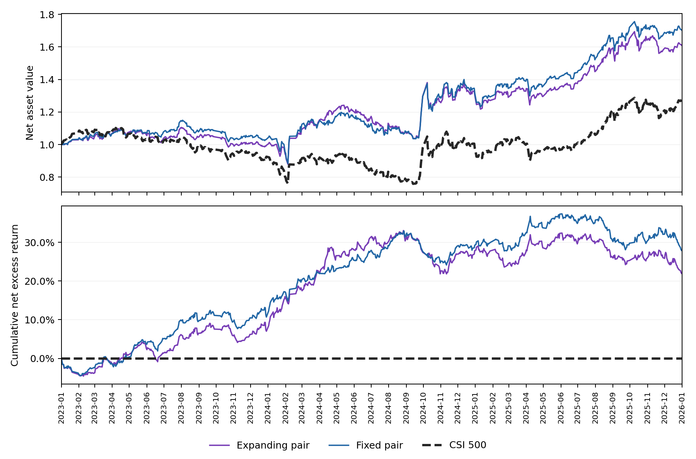

# 中证500日频选股：固定起点的扩展窗口

扩展训练的扣费累计收益为 **61.08%**，固定模型为 **70.41%**，相差 **-9.32 个百分点**。两者日频选 50 只，沿用同一组已冻结的 LightGBM 和 XGBoost 参数、MAD Alpha158、交易规则及费率。

**表 1　训练窗口与各自然年扣费收益**

| 预测年 | 训练信号区间 | 早停年 | 有效训练股票日 | 扩展训练收益 | 固定模型收益 | 指数收益 |
| --- | --- | --- | --- | --- | --- | --- |
| 2023 | 2014-01-02 至 2021-12-31 | 2022 | 917,916 | -0.46% | 3.25% | -7.42% |
| 2024 | 2014-01-02 至 2022-12-31 | 2023 | 1,038,666 | 30.86% | 27.39% | 5.46% |
| 2025 | 2014-01-02 至 2023-12-31 | 2024 | 1,159,525 | 23.67% | 29.55% | 30.39% |

每年更新八个模型。训练起点固定，前一个完整自然年用于 NDCG@50 早停，仅使用在各自区间内已实现的收益标签。固定对照沿用 2021 年早停、2022 年验证选参的正式归档。2022 年也作为首个扩展窗口的早停年；更晚的窗口可使用已经结束的历史测试年份。全期持仓与资金跨年延续。

**表 2　全期组合绩效**

| 策略 | 累计收益 | 绝对年化 | 年化超额 | 信息比率 | 最大超额回撤 |
| --- | --- | --- | --- | --- | --- |
| 扩展训练 | 61.08% | 16.89% | 7.19% | 0.851 | -11.20% |
| 固定模型 | 70.41% | 19.06% | 9.14% | 1.151 | -9.43% |
| 中证500 | 27.30% | 8.22% | 0.00% | — | 0.00% |

回测覆盖 727 个交易日，初始资金 1 亿元，每日计划替换 5 只股票，买入费率 5 bp、卖出费率 15 bp。累计收益和绝对年化由扣费日收益复利计算。年化超额由扣费日收益减当日指数收益后取算术平均，再乘以 238。

**表 3　全期排序与预测前50的真实收益名次占比**

| 策略 | 1−NDCG@50 ↓ | IC | ICIR | Rank IC | Rank ICIR | 前50 | 前100 | 后50 | 后100 |
| --- | --- | --- | --- | --- | --- | --- | --- | --- | --- |
| 扩展训练 | 0.48728 | 0.0163 | 0.1540 | 0.0302 | 0.2484 | 8.90% | 20.25% | 7.54% | 17.16% |
| 固定模型 | 0.48896 | 0.0163 | 0.1599 | 0.0308 | 0.2643 | 8.85% | 20.11% | 7.72% | 17.58% |

每天将八个排序器各自的分数转成股票排名百分位，同类的四个目标各占 25%，两类树各占 50%。在 725 个可评价交易日，每天从有真实收益的股票中取预测前 50 只，计算落入相应真实收益排名的比例。真实收益取 T+2 相对 T+1 的复权收盘涨幅，跨年但在测试期内的收益也计入。回测选股使用当天所有有效预测。2023–2025 年已在本项目此前的实验中观察。

图 1　日频 offset 0。上图为策略扣费净值与中证500净值，下图为扣费日收益与指数日收益之差的逐日累加，包含所有测试交易日。

[实验配置](csi500_research/sources/ml_study/daily_expanding_pair_20261122_133152_853377/config.json) · [比较指标](csi500_research/sources/ml_study/daily_expanding_pair_20261122_133152_853377/comparison.csv) · [逐日账本](csi500_research/sources/ml_study/daily_expanding_pair_20261122_133152_853377/ledger.parquet) · [固定模型归档](csi500_research/sources/ml_study/daily_pair_tuning_20261122_100328_550844/comparison.csv)
