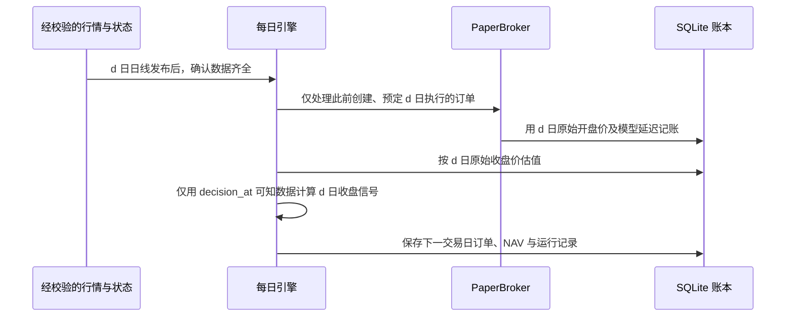

# A 股交易与前向模拟系统：P0 仓库审查及设计

审查日期：2026-11-04（Asia/Shanghai）。本阶段完成审查、设计和研究功能基线检查；尚未实现交易系统，不产生模拟成交或可信绩效。按要求分阶段交付，P1–P4 是后续工作。

## 1. 仓库现状与保护边界

已阅读工作区内全部 9 个 Python 源文件、README、忽略规则，并检查全部 7 个本地 Parquet 文件的 schema、日期范围、主键和价格字段。另读取 Git 中已删除的 `src/data/process.py`，仅用于理解旧处理流程，没有恢复它。工作区原有修改涉及下载、因子构建、评估及字节码；本阶段不改动这些文件，不重跑下载或覆盖任何研究产物。

| 路径 | 当前职责 | 复用与调整安排 |
| --- | --- | --- |
| `src/data/download.py` | TuShare 客户端、交易日历、按月指数权重下载 | 保留数据来源；后续将请求逻辑提取为无导入副作用的函数，旧脚本继续调用 |
| `src/data/download_market.py` | membership 股票并集的行情和复权因子下载 | 修正合并键、限流和分批持久化，在原管线中增加增量更新 |
| `src/data/universe_process.py` | 权重快照向后 as-of 展开为日 membership | 复用映射；补足真实公告时间、生效区间与数据版本，不能把月度快照当成精确历史调样记录 |
| `src/features/momentum.py` | `prices.pct_change(window)` | 复用纯函数；交易调用前按交易日历对齐并检查数据 |
| `src/features/targets.py` | 未来收益研究标签 | 继续用于研究，禁止传入交易策略上下文 |
| `src/evaluation/*` | IC、RankIC、分位数组收益 | 保留研究用途，不把分位数平均收益直接当账户净值 |
| `src/scripts/build_factor.py` | 动量和未来收益联合面板 | 保持原输出；交易策略从受控行情视图计算分数 |
| `src/scripts/evaluate_factor.py` | 研究评估表 | 保留，账户绩效另按账本计算 |

当前没有 `pyproject.toml`、依赖清单、YAML 配置、SQLite、交易代码、Cron 或 CI。`src` 使用隐式 namespace package，研究入口依赖相对导入。P1 以仓库根目录下的 `python -m src.trading.cli ...` 为入口，不为改包名重写研究代码。

当前运行环境为 Python 3.13.11，满足 3.11+；已有 Pandas 3.0.6、NumPy 2.5.3、PyArrow 24.0.0、TuShare 1.4.29、SciPy 1.18.1、Matplotlib 3.11.2。缺少 Pytest、PyYAML 和 Streamlit。P1 添加明确依赖和 Pytest 配置，P4 再加入 Streamlit。Python 3.11 环境兼容性尚未实际验证。

## 2. 实际数据盘点

以下数字来自本地文件扫描，不是下载脚本的预期输出。机器可读快照见 [p0_data_audit.json](p0_data_audit.json)，包含 schema、内容哈希及检查结果。

| 文件（相对项目根目录） | 行数 / 股票数 | 日期范围 | 关键字段 |
| --- | --- | --- | --- |
| `data/raw/daily/daily_2024_csi` | 144,460 / 598 | 2024-01-02–2024-12-31，242 日 | `ts_code, trade_date, open, high, low, close, vol, amount, adj_factor` |
| `data/interim/daily/daily_2024_clean_csi` | 144,460 / 598 | 同上 | 同上；日期已转 timestamp，按股票、日期排序 |
| `data/processed/daily/processed_2024_clean_csi` | 144,460 / 598 | 同上 | `ticker`、原价、`adj_factor`、四价的 `_hfq` 和 `_qfq` |
| `data/processed/factors/factor_data` | 96,620 / 598 | 2024-04-03–2024-12-03，162 日 | `mom_{5,10,20,60}` 和 `future_ret_{1,5,10,20}` |
| `data/raw/universe/csi500_weight_snapshots.parquet` | 61,000 / 1,264 | 2015-12-31–2026-01-30，122 个快照 | `con_code, trade_date, weight, index_code` |
| `data/processed/universe/csi500_membership.parquet` | 1,215,000 / 1,263 | 2016-01-04–2025-12-31，2,430 日 | `ticker, weight, trade_date, source_snapshot_date` |
| `data/raw/calender/trade_calender_2016_2025.parquet` | 2,430 个开放日 | 2016-01-04–2025-12-31 | `exchange, cal_date, is_open, pretrade_date` |

实际发现：

- 7 个文件均可读，无列内空值；股票日期主键没有重复。已有 OHLC 价格为正且边界关系有效，成交量和成交额非负。
- 2024 年 membership 并集恰为 598 只，行情覆盖代码并集一致，原始与 processed 行情主键一致。**代码齐全不代表逐日齐全**：121,000 个成分股票日中，66 个缺少行情，涉及 11 只股票。例：`600282.SH / 2024-01-12`、`000559.SZ / 2024-04-17`。没有停牌数据，不能判定这些缺口都是正常停牌。
- membership 每日 500 只，快照没有来自未来的日期，但来源快照最长滞后 35 个自然日。缺少公告与可获得时间，不能据此证明严格 PIT。权重总和最大偏离 100 为 0.019 个百分点，属于需要明确处理的舍入差异。
- 813 个股票日发生复权因子变化，涉及 527 只股票。这是公司行为风险线索，不等同于已识别 813 个可正确记账的公司行为。
- processed 前复权价精确符合 `raw_price * adj_factor / 每只股票样本末尾 adj_factor`。固定分母在同一股票的动量比值中抵消；不能仅因分母取样本末日就断言这个动量公式必然泄漏未来。绝对价格水平、数据修订及数据可获得性仍需另行控制。
- 本地存储的 `mom_20` 与现有函数重新计算一致。联合面板 `dropna()` 同时受 60 日 warmup 和 20 日未来标签影响，截掉了可用于实时决策的日期；不能用它决定历史或前向的可选股票集合。
- 行情没有 `pre_close`，也没有涨跌停价、停牌状态、历史 ST、上市退市信息、公司行为明细、指数行情及可获得时间。日历没有 2026 年，无法启动当前日期的前向运行。
- 日线、因子等文件虽然没有 `.parquet` 后缀，实际都是 Parquet。适配器直接读取，不批量改名或复制已有数据。

## 3. 已定位的问题

| 优先级 | 位置 | 证据、影响与处理 |
| --- | --- | --- |
| 阻断 | `src/data/download_market.py:43` | TuShare 两个返回表使用 `ts_code`，代码却按 `ticker` 合并，会触发缺键错误。P2 接通真实数据前修复并验证一对一合并 |
| 阻断 | 所有下载及处理脚本 | 顶层直接联网、读写；不能被交易模块安全 import。在原模块提取函数，脚本执行置于 main guard，不复制第二套下载逻辑 |
| 阻断 | membership 来源 | 月度权重不是公告与精确生效区间；旧快照展开不能证明真实历史调样。严格模式要求可验证数据，近似模式必须显式标注 |
| 阻断 | 行情与元数据 | 缺停牌、涨跌停、ST、公司行为覆盖与可获得时间；缺口不能默认为可交易或零收益 |
| 高 | `src/data/download_market.py:16` | 固定月份 × 全历史股票并集 × 两接口，2015-09–2026-02 为 126 个月；以当前 1,263 只并集估算 318,276 次请求。只在两个请求之间 sleep，无完整限流、重试、断点及早期落盘 |
| 高 | `src/scripts/build_factor.py:34` | 按未来标签联合删行；交易上下文禁用该面板，保留其研究输出 |
| 高 | 旧价格处理、动量调用 | `pct_change(20)` 默认按行而非市场交易日，停牌缺行时不一定是 t-20。交易适配器先对齐交易日历，禁止未经验证的填充 |
| 中 | 各脚本的固定绝对路径 | 根路径从配置/文件位置解析，原默认数据目录保留 |
| 中 | `src/data/download.py` 与本地文件 | 当前 raw 输出名带 `.parquet`，已有文件不带；脚本固定请求范围与权重文件内容范围也不完全一致。需要记录生成配置和批次，不声称现有文件能由当前脚本原样复现 |
| 中 | `assign_quantiles` | 对大量相同分数可能触发 `qcut` 重复分位边界错误；新交易选股使用分数与代码稳定排序，不把研究分位数函数当选股器 |
| 中 | Git 追踪的 `__pycache__` | 后续补忽略规则、依赖锁定；本阶段不删除用户工作区已有文件 |

## 4. TuShare 单位、权限与数据契约

以下是 2026-11-04 查阅的官方文档信息，**不是当前 Token 的权限实测**。环境中存在 `TUSHARE_TOKEN`，本阶段没有使用它发起请求、检查积分或触发付费操作。

| 接口 | 用途与重要口径 | 文档权限/限制 |
| --- | --- | --- |
| [daily](https://tushare.pro/document/1?doc_id=27) | 未复权日线；停牌期不提供记录；通常 15–16 时入库；`vol` 为手、`amount` 为千元 | 120 积分试用 50 次/分钟；5,000 积分基础档 500 次/分钟；单次 6,000 行 |
| [adj_factor](https://tushare.pro/document/2?doc_id=28) | 原始复权因子；文档说明当日盘前更新 | 具体档位以官方权限页与实际探测为准；不能由 daily 可访问推断该接口也可访问 |
| [index_weight](https://tushare.pro/document/2?doc_id=96) | 月度成分及权重，按月查询；权重以百分数表示 | 至少 2,000 积分 |
| [trade_cal](https://tushare.pro/document/2?doc_id=26) | 开放日、前交易日；前向需更新至实际运行期并覆盖下一交易日 | 2,000 积分 |
| [stk_limit](https://tushare.pro/document/2?doc_id=183) | 当日涨跌停价，文档说明约 9 点更新；指定字段请求 | 2,000 积分，单次最多 5,800 行，需处理截断 |
| [suspend_d](https://tushare.pro/document/2?doc_id=214) | 停复牌事件及时间；需展开状态区间，空结果不自动证明当日全部正常 | 至少 2,000 积分，单次 5,000 行 |
| [stock_basic](https://tushare.pro/document/2?doc_id=25) | 市场、上市退市日期；分别处理 L/D/P 等状态，避免只拉当前上市股 | 2,000 积分，单次最多 6,000 行 |
| [dividend](https://tushare.pro/document/2?doc_id=103) | 预案/实施进度、登记/除权/派息/红股上市日；税前和税后字段不能混用 | 2,000 积分，单次 2,000 行，通常 20–21 时更新 |
| [index_daily](https://tushare.pro/document/2?doc_id=95) | 官方 `000905.SH` 指数比较序列；独立于等权策略 | 2,000 积分 |

历史 ST 需要名称/风险警示的有效区间和公告时间。`namechange` 等候选接口需在数据接入阶段核实权限、覆盖和修订口径，禁止用当前股票名称回填整个历史。分红接口也不能覆盖全部配股、合并、退市等事件；这些事件必须另有完整性声明。

交易适配器统一使用：股票代码 `ts_code`、交易日期 `date`、原始价 `raw_*`（元/股）、复权因子 `adj_factor`、成交量 `volume_shares = vol * 100`、成交额 `amount_cny = amount * 1000`。不改研究文件的 `ticker`、原有字段和单位。股份成交量可有小数手，转换后验证接近整数股，不直接截断。成交单位规则和行情的“手”是两件事，科创板也不能把行情量乘 200。

本地 `amount_cny / volume_shares` 均处于当日高低价容差内，与上述单位一致；这只是交叉检查，单位依据仍是官方文档。

每个原始批次的 manifest 至少包含：`batch_id, source, endpoint, request_params, trade_date_range, fetched_at, updated_at, sha256, row_count, schema_version, completeness_status`，并保存原始响应。各记录/分区关联 `available_at` 及其证据类型、首次观测时间和修订版本。临时文件校验成功后原子替换并提交 manifest；失败批次不成为可用数据。

区分两个时间：`trade_date/effective_at` 表示市场事件何时发生，`available_at` 表示决策者何时能获得该版本。`fetched_at` 是本系统下载时间，不能伪造成历史发布时间。历史数据只有当前修订版本时，不能证明历史 PIT：默认严格模式拒绝；显式研究重建模式可以声明发布时间假设并输出 `reconstructed/unverified`，不得标为可信。旧文件 mtime 不作为可获得时间。

## 5. 最小兼容架构与接口

计划新增目录如下；本阶段尚未创建这些交易模块。

```text
src/trading/
  data/          # 现有 Parquet 的只读适配器、PIT 视图、质量与完整性检查
  strategies/    # Momentum20、Reversal20、CSI500EqualWeight
  portfolio/     # 股票筛选、目标数量、调仓与风险约束
  broker/        # PaperBroker、执行模型、按日期生效的规则与费用
  account/       # SQLite schema、账本、事务、恢复、公司行为
  engines/       # 共用日处理流程、backtest、paper
  analytics/     # NAV、成本、换手、风险与基准指标
  monitoring/    # 数据错误报告、运行状态、日志
  cli.py
configs/
  paper.yaml
  backtest.yaml
  trading_rules.yaml
tests/
  test_research_baseline.py
  test_data_pit.py
  test_strategy.py
  test_portfolio.py
  test_broker.py
  test_account.py
  test_backtest.py
  test_paper.py
  test_analytics.py
  test_corporate_actions.py
```

采用少量明确的 Python 数据类、DataFrame 与接口，不引入依赖注入框架、事件总线或分布式服务。

| 接口（计划） | 输入 → 输出 / 不变量 |
| --- | --- |
| `MarketData.snapshot(decision_at, history_start)` | 经校验的 PIT 行情、股票池和证券状态；拒绝未来版本及未解决缺口 |
| `Strategy.generate(context)` | `decision_date, decision_at, history, universe, optional_features` → `ts_code, score, target_weight`；不接收未来标签或执行日行情 |
| `Portfolio.plan(targets, account, decision_snapshot)` | 经筛选目标、账户、当日已知原始收盘价 → 卖单优先的确定性订单计划 |
| `Broker.execute(orders, execution_context, unit_of_work)` | 订单、执行日开盘价/事前规则/冻结容量 → 成交、拒绝或失效；账户和成交同事务更新 |
| `Ledger.load(account_id)` | SQLite → 完整账户、分批持仓、可卖数量和上次成功日期 |
| `Engine.process_day(trade_date, settlement_at)` | 验证、结算旧订单、估值、生成下期计划、原子提交；回测与前向复用 |

未来 QMT 适配器实现同类订单/成交边界，但要支持异步确认和回报对账；策略不直接访问券商或数据库。当前只实现虚拟券商。

## 6. 决策与执行时序：共享一套规则



订单记录 `signal_date, decision_at, scheduled_trade_date, reference_price_date`；成交记录 `fill_date` 和 `recorded_at`。必须满足 `signal_date < scheduled_trade_date == fill_date`，且 `decision_at` 早于执行日开盘。`recorded_at` 是日线到齐后的实际记账时间；绝不称为盘中实时成交。历史重放同样按当时的决策边界推进。

**信息隔离：**日处理器可以读到 d 日完整日线用于收盘估值和延迟结算，但开盘执行模型只接收原始 `open`、事前可知的停牌/涨跌停/规则，以及在信号时冻结的容量参数。不得用 d 日收盘价重算数量，也不得用 d 日最高最低价决定最优成交或裁剪滑点；不得用 d 日全日量反推开盘可成交量。

容量以 t 日及以前 20 个交易日平均成交股数乘参与率确定，在 t 日冻结。该模型只是日线条件下的容量近似，不能证明开盘真实有该流动性。实际日线成交量为零或停牌数据矛盾属于数据检查/禁止成交原因，不提高容量。后续有开盘集合竞价或分钟数据时再更换执行模型。

周调仓默认在每个 ISO 交易周的最后一个开放日收盘产生信号，下一开放日执行；节假日以交易日历决定，不机械用周五。首次建仓在满足 warmup 后的第一个调仓日进行，结束日后不模拟未观察的成交。非调仓日仍结算、估值和检查公司行为。

Momentum20 使用市场交易日 t-20，而不是倒数第 20 条非空行情：

`score = (raw_close[t] * adj_factor[t]) / (raw_close[t-20] * adj_factor[t-20]) - 1`

复用 `calc_momentum` 时，先按股票和交易日历对齐，验证端点及可获得时间；无充分历史的股票明确排除并记录原因。已确认停牌的缺行情和未知缺行情分开处理，禁止 Pandas 默认填充掩盖缺口。Reversal20 为负分数。并列按 `ts_code` 排序以保证复现。

## 7. 组合、成交与历史规则

配置保留用户默认：初始 1,000,000 CNY、CSI500、20 只、每周、等权、至少 5% 目标现金、单只目标权重至多 5%、无融资融券。20 只齐全时每只目标为 **4.75%**。不足 20 只不突破上限，不为满仓强买；无法执行的卖单仍占持仓和风险预算，不提前计入卖出收入。

候选风控默认值在 P1 配置中明确落地：上市至少 120 个市场交易日、过去 20 日平均成交额至少 10,000,000 CNY、单笔计划名义金额不超过调仓前 NAV 的 5%、单次调仓买卖总额之和不超过调仓前 NAV 的 100%、单股容量不超过事前 20 日平均成交股数的 1%。这些是可修改的模拟策略假设，不是监管要求。持仓中的停牌股不因无法买入而消失；目标减持仍遵守可卖和停牌规则。

目标数量基于 t 日原始收盘价、可用现金及预计费用，按证券与执行日期对应的单位向下取整。先卖后买；开盘跳空后重新检查实际现金、订单金额与风险预算，数量只能缩减不能因新行情加大。可执行部分成交，余量当日失效；不足最小单位则拒绝。直接提交非法单位的订单明确拒绝，不静默改写原订单数量。

| 市场/板块 | 数量模型 | 依据与实施要求 |
| --- | --- | --- |
| 沪深主板、创业板 | 买入至少 100 股、按 100 递增；不足单位的卖出尾数按规则一次处理 | [上交所现行规则](https://big5.sse.com.cn/site/cht/www.sse.com.cn/lawandrules/sselawsrules2025/stocks/exchange/c/c_20260424_10816482.shtml)、[深交所创业板说明](https://www.szse.cn/aboutus/trends/conference/t20200821_580925.html)；回测还需对应历史版本 |
| 科创板 | 至少 200 股，超过部分可按 1 股递增；卖出不足 200 的余额一次卖出 | [上交所投资者教育](https://edu.sse.com.cn/tib/qa/)；卖单不能统一按 100 股整手截断 |
| 北交所 | 至少 100 股，不要求 100 的整数倍；不足 100 的余额一次卖出 | [北交所交易规则第 3.3.8 条](https://www.bse.cn/uploads/6/file/public/202109/20210909101516_y5wn2y3ft9.pdf)；接入时确认适用版本及证券身份，不能只靠代码前缀 |

规则表按 `exchange, board, valid_from, valid_to` 选择，记录来源、版本及已实施/暂缓状态。未知市场、日期范围未覆盖或规则冲突直接失败。已有证券元数据用于识别市场，未来代码迁移以证券身份映射处理。

必须覆盖的日期边界示例：

- 创业板存量股票自 2020-08-24 起涨跌幅调整至 20%，最小申报数量仍为 100 股或整数倍。[深交所 2020-08-21 说明](https://www.szse.cn/aboutus/trends/conference/t20200821_580925.html)
- 自 2023-08-28 起证券交易印花税减半；模拟费率表按卖出方向及日期选择，不把新费率应用于旧日期。[上交所通知](https://www.sse.com.cn/aboutus/mediacenter/hotandd/c/c_20230827_5725662.shtml)
- 深市股票经手费自 2023-08-28 起由 0.0487‰ 降至 0.0341‰；佣金是否包含经手/监管费必须配置，避免重复收取。[深交所通知](https://www.szse.cn/disclosure/notice/t20230818_602805.html)
- 上交所 2026 修订规则于 2026-07-06 生效，且存在暂缓实施条款；深交所同日起实施新版风险警示板指南。不能继续把所有日期的主板 ST 一律写成 5%。[上交所发布及附件](https://big5.sse.com.cn/site/cht/www.sse.com.cn/lawandrules/sselawsrules2025/stocks/exchange/c/c_20260424_10816482.shtml)、[深交所指南通知](https://www.szse.cn/lawrules/service/member/t20260630_621404.html)

优先使用证券当日的官方涨跌停价格及明确的无限价标志，不从现价机械乘固定百分比。缺少限制信息不能解释为无限价。保守规则：开盘触及涨停不买、触及跌停不卖；拒绝停牌、开盘状态不明和滑点后越过合法价格边界的成交。股票 T+1 按交易日历和持仓批次锁定；当日买入不能补足当日卖出可卖数量。测试还须直接调用 Broker 验证此约束，不能仅靠引擎恰好每天执行一次。

滑点默认候选 5 bps：买价 `open * (1+s)`，卖价 `open * (1-s)`，再按最小价位保守取整。滑点已计入成交价，其金额另列用于分析，**不可再次从现金扣除**。佣金候选为成交金额的 0.03%、单笔最低 5 CNY，属于模拟假设；印花税、过户费和另计费用按已核实的历史表收取。过户费历史版本及当前费率、全部市场收费覆盖尚未完成一手资料核验，P1 必须补足后才启用对应区间，禁止默认为零。

第一版每单每执行日最多一笔模拟成交，按订单收取最低佣金；部分成交的剩余量当日失效。保留 `NEW/PLANNED, FILLED, PARTIALLY_FILLED_EXPIRED, REJECTED, EXPIRED, CANCELLED` 状态、请求数量、已成交数量及标准化原因码，终态不可重复撮合。不同策略用独立账户隔离，不混用现金和持仓。

## 8. SQLite 账本、幂等与恢复

P1 即使用 SQLite 实现 Account 与 Broker 的事务边界；P3 完成每日运行调度、补跑和恢复流程，不到 P3 才补资金一致性。

| 表 | 关键内容与约束 |
| --- | --- |
| `accounts` | `account_id, strategy_id, currency, initial_cash, cash, last_committed_date, config_hash`；初始资金只记一次 |
| `position_lots` | 买入日期、总数、剩余数、`sellable_from`、成本；整数股且非负 |
| `orders` | 用户要求的全部订单字段，附决策/计划执行时间、序号、已成交数、状态；逻辑订单键唯一 |
| `fills` | 用户要求的全部成交字段，附 `recorded_at, transfer_fee, other_fees, rule_version`；第一版 `order_id` 唯一 |
| `cash_entries` | 初始入金、买卖金额、各费用、派息/税款等带正负方向流水，关联源事件；来源键唯一 |
| `fees` | 费用分项及成交/公司行为来源；不能与现金流水重复计费 |
| `daily_positions` | 账户/日期/证券唯一，持仓与可卖数、估值价及来源、价值、权重 |
| `daily_nav` | 账户/日期唯一，现金、股票市值、应收、负债、总资产、NAV、可信状态与原因 |
| `runs` | 策略/配置/代码版本、数据哈希、运行日期、状态、开始结束时间及错误报告 |
| `corporate_actions` | 事件及版本、权益登记与到账状态，P1 先用于未处理事件阻断 |

资金和费用使用明确舍入规则的 Decimal 计算，持久化为整数分；股价按证券 tick 量化，权重和分析用浮点。佣金/税费逐项舍入，金额与现金流水对账。数据库启用外键、CHECK、唯一约束、WAL 和 `busy_timeout`。

每账户日处理先获取写锁并检查 `last_committed_date`；同一数据库内以 `BEGIN IMMEDIATE` 保证订单、成交、现金、持仓、日快照、下期计划及成功运行记录原子提交。网络请求和数据准备在事务外完成，事务内只使用已冻结数据。异常回滚后单独写失败日志，不留半笔成交。

幂等键取账户、策略、信号日期、计划执行日期、证券、方向、计划序号等确定性字段，不能每次随机生成新订单。已成功日期重复运行返回原结果；发现相同日期但配置或数据哈希不同，报冲突，不覆盖历史。修改策略需新账户/新回测，或显式迁移。

崩溃后从数据库重新加载，恢复可卖批次；失败日期可重试。遗漏交易日按日历顺序补跑，拒绝跳过未结算日直接生成新信号。历史回测每次分配独立 run/account，保存规范化配置、随机种子（有模型时）、代码版本、未提交代码差异哈希、数据版本及规则版本，不能只保存 Git HEAD。

## 9. 数据缺口、公司行为与可信状态

必要数据检查覆盖：当期候选池、已有持仓、待执行订单涉及证券、基准及所需历史窗口。唯一键、OHLC、非负量额、复权因子为正、日期与时间边界、证券状态和版本覆盖均需验证。重复冲突不静默去重，未知缺行情不前向填充。

失败报告包含 `run_id, trade_date, dataset, ts_code, missing_fields/dates, source_batch, reason`；CLI 非零退出，不提交成交或新 NAV。非交易日仅在日历完整时安全退出；数据未发布或日历缺失不是休市。已确认停牌的持仓可在明确记录来源及陈旧天数后用上次有效估值，且必须检查期间公司行为；无法解释的缺价阻断。

P1–P3 检测公司行为：复权因子变化、实施事件以及原价/除权参考价异常交叉检查。公司行为数据覆盖本身缺失也要阻断，不能用“未查到事件”等同于“无事件”。持仓或权益跨越未支持的除权、送转、配股、合并、退市等日期时，默认停止该日记账，报告待处理权益；如需诊断展示，仅可输出独立的 `unverified` 结果，禁止作为可靠绩效。

P4 实现：登记日锁定权益；除权日确认现金应收或待上市股份，派息日现金到账、红股上市日解除对应锁定；送转/拆并调整股数和单位成本；按账户税务身份与持有批次处理递延红利税，退市/合并/配股使用明确事件和配置政策。事件修订和重试幂等；未知事件仍阻断。价格复权只用于研究，不能代替真实现金或股数变动。

可信状态分别记录数据 PIT、行情完整性、规则覆盖、公司行为覆盖和估值状态，任一失败不能显示整体可信。历史数据只有事后重建版本时，即使资金账平也不得标为严格 PIT 结果。

## 10. 基准与绩效口径

提供两个明确命名的比较对象：

1. `000905.SH` 官方中证500价格指数：归一化为 1，不冒充含分红总回报指数。
2. `CSI500EqualWeight` 可交易策略：当时可知成分等权，目标数量改为全部合格成分，使用同一 Broker、费用、调仓日和默认现金缓冲；单独显示筛选、费用和现金拖累。不是把 500 只股票收益每天简单平均后称作可交易净值。

账户无外部追加/提取资金时，以初始资金为基准；起始现金时点单独保留为 NAV0。若未来支持出入金，需要单位化/TWR，不能继续直接用资产比例。

| 指标 | 固定口径 |
| --- | --- |
| Daily NAV | `(cash + Σ(quantity * raw_close) + receivables - liabilities) / initial_cash`，逐日附质量状态 |
| Total Return | `NAV_end / NAV_start - 1` |
| Annualized Return | `(NAV_end / NAV_start) ** (252 / n_returns) - 1`，n 为实际观察的交易日收益个数 |
| Annualized Volatility | 日简单收益的样本标准差 `std(ddof=1) * sqrt(252)` |
| Sharpe | `(mean(r) - rf_daily) / std(r, ddof=1) * sqrt(252)`，`rf_daily=(1+rf_annual)**(1/252)-1`，默认无风险利率 0 |
| Maximum Drawdown | `max(1 - NAV / cumulative_max(NAV))`，含初始 NAV0，报正的损失比例 |
| Calmar | 年化收益 / 最大回撤；零回撤时未定义，不伪造 0 |
| Excess Return | `(1 + portfolio_total_return) / (1 + benchmark_total_return) - 1`；另列累计收益百分点差以免混淆 |
| Information Ratio | 对齐日历后的主动日收益 `a=r_portfolio-r_benchmark`，`mean(a)/std(a,ddof=1)*sqrt(252)` |
| Turnover | 同时报告 gross=`Σ(abs(fill_notional))/前交易日总资产`、one_way=`gross/2`；初始建仓分母为初始资金；风控上限使用 gross |
| Transaction Costs | 佣金、税、过户及其他实付费用之和；滑点相对开盘价的估算另列，不重复扣款 |
| Exposure | 股票原始价市值 / 总资产；另列现金、冻结持仓及应收占比 |

短样本、零波动、基准缺失或缺交易日时输出 NaN/错误及原因，不删除日期伪造平滑结果。缺基准可以保留已完整结算的账户账本，但比较指标明确不可用；需要基准的验收运行必须检查其完整性。精确公式测试放在 P4，不把 ICIR 当 Sharpe。

## 11. 分阶段交付与验收

| 阶段 | 实施范围 | 阶段结束必须实际执行的检查 |
| --- | --- | --- |
| P0（本次） | 全仓审查、数据 schema/单位/缺口、设计、现有研究函数基线 | `python -B -m unittest discover -s tests -p 'test_research_baseline.py' -v`；本地数据只读检查；全部源码 AST 检查 |
| P1 | 交易数据契约及内存夹具、三策略、筛选和 Portfolio、日期规则/费用、PaperBroker、SQLite Account、公司行为阻断 | 研究基线 + `test_data_pit/strategy/portfolio/broker/account`；SQL 回滚、现金守恒、T+1、数量/费用历史边界 |
| P2 | 在原数据管线提取可复用函数并修复合并、Parquet 适配器、历史数据冻结与必要元数据补齐、顺序回测、结果导出 | 追加未来数据不改变历史决策；t 收盘不能填 t 开盘；warmup/节假日；独立多策略及配置/数据复现 |
| P3 | 每日前向、真实增量下载、权限与完整性探测、运行日志、补跑/恢复、Cron | 同日重复/重启/中断回滚；冻结数据下逐日前向与回测一致；漏跑补跑；Asia/Shanghai 与服务器时区无关 |
| P4 | 支持的公司行为全流程账务、绩效和两类基准、Streamlit 只读页面、回归 | 公司行为现金/应收/股数及税务测试；关键指标人工解；全部测试；冻结数据端到端及真实数据质量审计 |

真实历史严格 PIT 元数据若无法取得，P2 仍先用人工冻结夹具验证引擎，真实数据报告停留在明确标注的研究重建状态；不得为通过验收伪造历史可获得时间。

用户 12 项验收的测试落点：

| 编号 | 人工构造用例 | 对应阶段/文件 |
| --- | --- | --- |
| 1 | 改变 t 日收盘价，只影响 t 后计划，不影响 t 已发生的成交；追加未来价格/成分不改历史 | P1/P2 `test_data_pit`, `test_backtest` |
| 2 | 同日买入后直接请求卖出被拒；周末和假期按下一交易日解锁 | P1 `test_broker`, `test_account` |
| 3 | 开盘跳空及最低佣金导致不足时拒绝/缩量，现金始终非负 | P1 `test_broker`, `test_portfolio` |
| 4 | 主板 99/100/101、科创板 199/200/201、北交所 99/100/101，卖出尾数单独验证 | P1 `test_broker`, `test_portfolio` |
| 5 | 全天/开盘停牌、未知状态、缺行情无成交 | P1/P2 `test_broker`, `test_data_pit` |
| 6 | 涨停开盘买入、跌停开盘卖出拒绝；正常方向与无限价状态分开测试 | P1 `test_broker` |
| 7 | 已知价格、滑点、最低佣金、税和过户费逐分手算；滑点不二次扣款 | P1 `test_broker`, `test_account` |
| 8 | 重复订单、重复执行同一天，订单/成交/现金/运行成功记录数量不变 | P1/P3 `test_broker`, `test_paper` |
| 9 | 文件 SQLite 关闭重开后现金、持仓、可卖量及 NAV 相同；写入中异常全回滚 | P1/P3 `test_account`, `test_paper` |
| 10 | 同一快照、规则和配置，回测与逐日前向的 NAV、持仓、订单、成交逐项相同 | P3 `test_backtest`, `test_paper` |
| 11 | 缺价/停牌不明/公司行为覆盖缺失或未处理事件，中止或输出显式不可信诊断，不发布可靠净值 | P1/P2/P4 `test_data_pit`, `test_account`, `test_corporate_actions` |
| 12 | 在规则生效日前后各构造一日，税费和涨跌停/单位规则按版本选择；未知日期拒绝 | P1/P2 `test_broker`, `test_backtest` |

P4 Dashboard 用 Streamlit 读取账本和导出结果，展示资产/净值/官方指数及等权组合、持仓权重、订单成交、费用回撤、运行状态及异常。读页面不生成订单、不修改账户；可信状态和模拟记账时间必须可见。

P3 计划入口（当前不可执行）：`python -m src.trading.cli paper --config configs/paper.yaml --date YYYY-MM-DD`；显式日期或 `ZoneInfo('Asia/Shanghai')` 计算日期，禁止 naive `datetime.now()` 隐式使用宿主时区。Cron 示例在部署时配置 `CRON_TZ=Asia/Shanghai`（需确认所用 Cron 实现支持），21:30 后运行，覆盖常见公司行为更新窗口；不支持 `CRON_TZ` 时通过 systemd calendar 指定时区或明确换算。到时仍须检查数据就绪，时间到了不等于数据齐全。加 `flock` 防重叠，凭据由受限环境文件注入，日志轮转和 SQLite 一致性备份；本阶段未安装定时任务。

## 12. P0 实际验证与剩余限制

新增 `tests/test_research_baseline.py`，仅冻结已有研究纯函数行为：20 日动量、固定复权锚点抵消、追加未来价格不改变已有动量、未来收益标签、IC/RankIC、分位数和组均收益。测试不下载、不写研究数据。它们不是交易系统验收测试，也不能证明现有研究整体无未来函数。

实际执行上述 unittest 命令：**8 项通过，退出码 0**。同时 9 个已有 Python 源文件及新增测试通过 AST 解析，7 个 Parquet 文件完成读取与检查；对原有 35 个源码、数据、结果和配置文件的 SHA-256 前后比对无变化。当前没有安装 Pytest，因此没有声称执行过 Pytest。

本地文件扫描、66 个成分日缺口及 813 次复权因子变化是数据审查结果；不会为了让检查全绿而忽略。没有运行下载/因子写盘脚本，没有新建资金账户，没有生成回测报告，没有连接真实券商。Token 权限、真实增量响应、完整历史规则与公司行为覆盖均待后续阶段验证。

P1 下一步先建立合成行情与证券规则夹具、SQLite 原子账本和最小 Broker，再接策略与调仓。历史数据和现有研究输出保持原样；新增真实数据请求仍回到原有 TuShare 管线实现。
