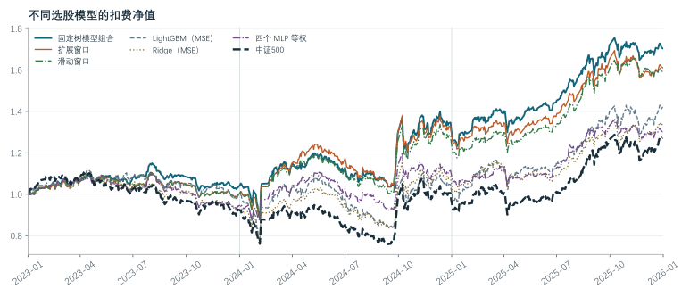
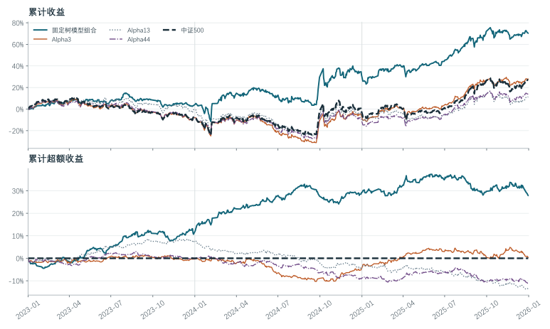

# 中证500多头选股策略研究——量价单因子、收益回归与截面排序的实证比较

本研究以中证500历史成分股为股票池，比较两类多头选股策略。第一类直接按量价因子选股，第二类用 Qlib Alpha158 特征预测个股收益或学习股票的相对次序。2023–2025 年，在相同持仓数量、调仓规则和交易费率下，LightGBM 与 XGBoost 等权排序组合的扣费累计收益和夏普率均高于三个单因子、两种回归模型及 MLP 组合。其净值最大回撤也小于中证500价格指数和三个单因子组合。

## 研究设计

**回测区间为 2023 年 1 月 3 日至 2025 年 12 月 31 日，以中证500价格指数为基准，使用 TuShare 日线行情。**

**回测方法。** 每个交易日按当时已知的成分名单确定股票池。各策略在 T 日收盘后打分，按 T+1 日复权收盘价模拟成交。回测统一使用 Qlib 的 `TopkDropoutStrategy`，目标持有 50 只股票（`topk=50`），每日计划替换 5 只（`n_drop=5`）。各组合初始资金均为 1 亿元，买入、卖出费率分别为 5 和 15 个基点，每笔最低收费 5 元。账本覆盖 2023 年 1 月 3 日至 2025 年 12 月 31 日，共 727 个交易日。

信号评价采用与成交时点一致的收益标签。对 T 日收盘后的预测，取 T+1 收盘至 T+2 收盘的复权收益，衡量信号与建仓后一个交易日收益的关联。测试期末两个信号日的收益终点超出回测区间，因此有 725 个交易日可用于评价预测。[执行设置与样本覆盖](docs/results/csi500_research/sources/ml_study/daily_expanding_pair_20261122_133152_853377/execution_audit.json)

**样本划分。** 单因子按既定公式逐日计算。机器学习模型使用 2013 年的历史行情预热特征，固定模型的训练期为 2014 年 1 月 2 日至 2020 年末。回归模型使用 2021–2022 年验证。固定树排序模型将这两年分开，2021 年用于早停，2022 年用于选择超参数。所有模型均在 2023–2025 年测试。训练、早停和验证样本的收益终点须落在各自区间内。滚动重训的窗口安排见第三节。[回归实验配置](docs/results/csi500_research/sources/ml_study/daily_mad_ridge_20261122_145614_730197/config.json)

## 一、传统单因子选股

本研究从华泰证券《华泰单因子测试之海量技术因子》考察的 101 个技术因子中选取三个量价因子。计算时先在每日成分股截面上排名，再沿每只股票的历史序列计算价量关系。**Alpha3** 取过去 10 个交易日开盘价排名与成交量排名的相关系数，再取负值。**Alpha13** 先计算过去 5 个交易日收盘价排名与成交量排名的协方差，再按当日各股的协方差排名并取负值。**Alpha44** 取过去 5 个交易日复权最高价与成交量排名的相关系数，再取负值。[华泰原研报，图表 40](https://crm.htsc.com.cn/doc/2019/10750101/dae9cd9e-c2cd-4f05-bb6c-e5ac8d216d3d.pdf) · [本项目因子公式](src/factors/price_volume.py)

### 预处理

每个因子分别保留原始分数和行业、市值中性化后的分数。中性化按交易日进行。先对因子值和对数总市值分别截尾，边界为当日截面中位数上下 5 倍中位绝对偏差（MAD）。再以因子值为因变量，以行业虚拟变量和对数总市值为解释变量做截面回归，并将回归残差在当日截面上标准化，作为选股分数。行情缺失、相关系数无定义或中性化所需变量缺失时，相应分数保留为空。[截尾、回归与残差标准化](src/factors/neutralization.py)

### 单因子回测结果

**表 1　三个单因子处理前后的单日收益预测及扣费回测**　[表格数据（CSV）](docs/results/csi500_research/tables/table_1_factors.csv)

| 因子 | IC | ICIR | Rank IC | Rank ICIR | 日 Rank IC 标准差 | 累计收益 | 净值最大回撤 |
|---|---:|---:|---:|---:|---:|---:|---:|
| Alpha3 · 原始 | -0.00073 | -0.00968 | **0.00579** | 0.07284 | 0.07943 | 11.48% | -39.47% |
| Alpha3 · 处理后 | **0.00044** | **0.00859** | 0.00569 | **0.10681** | **0.05326** | **27.81%** | **-37.39%** |
| Alpha13 · 原始 | 0.00190 | 0.02405 | **0.02023** | 0.24802 | 0.08155 | **16.68%** | -34.80% |
| Alpha13 · 处理后 | **0.00381** | **0.06930** | 0.01814 | **0.32276** | **0.05621** | 11.36% | **-31.88%** |
| Alpha44 · 原始 | 0.00116 | 0.01470 | 0.01476 | 0.16767 | 0.08806 | **14.54%** | -34.52% |
| Alpha44 · 处理后 | **0.00388** | **0.07242** | **0.01577** | **0.27985** | **0.05635** | 13.87% | **-32.88%** |

表 1 对每个因子分别做配对比较，仅在原始分数、处理后分数和未来收益均有效的股票日上计算相关性。IC 和 Rank IC 分别为当日分数与未来收益的 Pearson 和 Spearman 相关系数，表中列示其逐日均值。ICIR 和 Rank ICIR 分别用对应均值除以日相关系数的样本标准差，均未年化。粗体标示同一因子处理前后的较优值，其中日 Rank IC 标准差越低，表示排名关联的日间波动越小。

组合回测按各策略当日所有有效分数选股，因此可投资样本与相关性检验的配对样本可以不同。三个中性化组合的净值和逐日手续费均与原实验账本一致。[配对 IC 明细](docs/results/csi500_research/sources/factors/daily_factor_processing_20261122_142859_680463/paired_ic.csv) · [六组回测结果](docs/results/csi500_research/sources/factors/daily_factor_processing_20261122_142859_680463/portfolio_metrics.csv)

**中性化后，三个因子的平均 IC 均提高，日 Rank IC 的标准差均下降。** Alpha3 和 Alpha13 的平均 Rank IC 略降，Alpha44 略升，但三者的 Rank ICIR 均提高。以 Alpha13 为例，平均 Rank IC 从 0.02023 降至 0.01814，日标准差从 0.08155 降至 0.05621，因此 Rank ICIR 从 0.24802 升至 0.32276。

在组合层面，中性化后三个因子的净值最大回撤均收窄，只有 Alpha3 的扣费累计收益提高，由 11.48% 升至 27.81%。Alpha13 的累计收益由 16.68% 降至 11.36%，Alpha44 由 14.54% 降至 13.87%。可见，整个截面上的排序关联更稳定，未必能提高前 50 只持仓的收益。

## 二、基于 Qlib Alpha158 的 Ridge 与 LightGBM

为检验多个量价特征联合预测收益的效果，本节以 Qlib Alpha158 的 158 个因子为共同输入，分别拟合线性的岭回归（Ridge）和非线性的 LightGBM 回归模型。两者预测同一收益标签，并按预测值从高到低选股。

两种模型在测试期均对 363,222 个股票日给出预测。两组预测的股票代码、交易日期和收益标签逐行一致，可直接比较。[共用特征与 LightGBM 配置](docs/results/csi500_research/sources/ml_study/daily_alpha158_comparison_20261121_105840_864298/preprocessing_test/sampling_mse/config.json) · [Ridge 同样本实验](docs/results/csi500_research/sources/ml_study/daily_mad_ridge_20261122_145614_730197/replay.py)

### 预处理

每个交易日分别对 158 个因子做截面截尾，将超出中位数上下 5 倍 MAD 的观测调整至相应边界，MAD 为零时保留原值。Ridge 使用训练集各列的中位数填补缺失值，再按训练集均值和标准差缩放特征，使各列在 L2 惩罚下具有可比尺度。LightGBM 直接使用截尾后的特征，在树节点分裂时处理缺失值。[Ridge 模型流程](src/ml/models.py)

两种模型均对收益标签做逐日截面 Z-score 标准化，即将每只股票的未来一日收益减去同日截面均值，再除以截面标准差。模型拟合的是股票相对于同日成分股的收益水平，测试期 IC 仍按原始收益计算。

### 训练与调优

Ridge 和 LightGBM 均使用 2014–2020 年的数据估计模型，并以 2021–2022 年验证集的均方误差（MSE）评价预测。Ridge 在训练平方误差上加入 L2 惩罚，惩罚系数固定为 100。

LightGBM 在同一验证集上选择迭代轮数和采样参数。特征采样率取 50% 或 70%，样本采样率取 80% 或 100%，其余树参数沿用基线设置。每组候选参数均按验证 MSE 早停，连续 50 轮未改善时停止。先保留各组验证误差最低的轮次，再比较各组在该轮次的验证误差。

最终采用第 4 组试验（Trial 4）的设置，特征采样率为 50%，样本采样率为 80%。该模型在第 138 轮取得最低验证 MSE（0.99668）。确定参数和轮数后，冻结模型并在测试期逐日生成预测。[调参配置](docs/results/csi500_research/sources/ml_study/daily_alpha158_comparison_20261121_105840_864298/preprocessing_test/sampling_mse/config.json) · [入选模型记录](docs/results/csi500_research/sources/ml_study/daily_alpha158_comparison_20261121_105840_864298/preprocessing_test/sampling_mse/summary.csv)

### 回测结果

**表 2　回归模型的验证误差、单日收益预测及扣费回测**　[表格数据（CSV）](docs/results/csi500_research/tables/table_2_regression.csv)

| 模型 | 验证 MSE | IC | ICIR | Rank IC | Rank ICIR | 日 Rank IC 标准差 | 累计收益 | 年化超额 | 净值最大回撤 |
|---|---:|---:|---:|---:|---:|---:|---:|---:|---:|
| Ridge | 0.99872 | 0.01551 | 0.14279 | **0.01985** | **0.17439** | **0.11385** | 33.26% | 1.21% | **-29.08%** |
| LightGBM | **0.99668** | **0.01768** | **0.15000** | 0.01341 | 0.10966 | 0.12232 | **42.17%** | **3.65%** | -31.29% |

表 2 的 MSE 来自 2021–2022 年验证集，其余指标来自 2023–2025 年测试集。LightGBM 的扣费累计收益为 42.17%，比 Ridge 高 8.91 个百分点，年化超额收益高 2.44 个百分点。Ridge 的平均 Rank IC 和 Rank ICIR 均高于 LightGBM，净值最大回撤也较小（−29.08% 对 −31.29%）。[Ridge 验证指标](docs/results/csi500_research/sources/ml_study/daily_mad_ridge_20261122_145614_730197/ridge_trials.csv) · [Ridge 回测](docs/results/csi500_research/sources/ml_study/daily_mad_ridge_20261122_145614_730197/portfolio_metrics.csv) · [LightGBM 验证与回测](docs/results/csi500_research/sources/ml_study/daily_alpha158_comparison_20261121_105840_864298/preprocessing_test/sampling_mse/summary.csv)

## 三、针对 TopkDropoutStrategy 回测策略的股票排序模型

本节将预测目标由个股收益水平改为同一交易日内的收益排序。主策略由四个 LightGBM 和四个 XGBoost 排序器组成，另设四个多层感知机（MLP）排序器作对照。每种算法均分别学习四个目标。A、B 提高未来收益前 50 名、前 100 名股票的排序权重，C、D 加大将未来收益后 50 名、后 100 名股票排在前列的代价。

每天收盘后，先将各排序器的分数转换为当日成分股中的排名百分位，再等权平均。单独使用一种算法时，每个排序器占 25%。合并 LightGBM 和 XGBoost 时，八个排序器各占 12.5%。组合按融合分数确定选股顺序，T+1 收盘执行 Top50/Drop5 调仓。因此，预测前 50 名单衡量当日选股信号，实际持仓还取决于前一日的持仓和当日换股数量。[增益及组合权重](docs/results/csi500_research/sources/ml_study/daily_expanding_pair_20261122_133152_853377/config.json)

### 预处理

**输入特征。** 三种排序算法沿用第二节的 Alpha158 特征和逐日 5 倍 MAD 截尾规则。两种树模型在节点分裂时处理缺失值。MLP 仅用训练集各因子的中位数填补缺失值，早停、验证和测试均沿用训练期中位数。[MLP 预处理配置](docs/results/csi500_research/sources/ml_study/mlp_report_median_20261126/config.json)

**排序标签。** 根据 T+1 收盘至 T+2 收盘的复权收益，将 T 日有有效标签的成分股分为五档。四个目标共用同一分档，以不同增益体现选股侧重（表 3）。例如，A 对前 50 名和第 51–100 名分别赋予 9 和 3 的增益，B 对这两档分别赋予 9 和 8，因此 A 更强调区分前 50 名与其后的 50 只股票。训练、早停和验证均要求收益终点落在对应区间内。

**表 3　四个排序目标的收益分档与增益设置**　[表格数据（CSV）](docs/results/csi500_research/tables/table_2_ranking_gains.csv)

| 目标 | 后50 | 倒数第51–100 | 中间股票 | 第51–100 | 前50 |
|---|---:|---:|---:|---:|---:|
| A · 优先选前50 | 0 | 1 | 2 | 3 | 9 |
| B · 优先选前100 | 0 | 1 | 2 | 8 | 9 |
| C · 优先避开后50 | 0 | 6 | 7 | 8 | 9 |
| D · 优先避开后100 | 0 | 1 | 7 | 8 | 9 |

### 训练与调优

**固定树模型按时间顺序完成估计、早停、选参和测试。**

1. **模型估计（2014–2020 年）。** 以交易日为排序组，用个股 Alpha158 特征预测同日股票的相对收益次序。LightGBM 采用 LambdaRank，XGBoost 采用 `rank:ndcg`。两种算法分别按表 3 的四套增益拟合四个排序器。同一算法内的四个排序器共用树超参数，各自学习与目标增益相对应的排序函数。
2. **选择迭代轮数（2021 年）。** 每个排序器最多训练 1,000 轮，逐轮计算早停集的 NDCG@50。该指标按预测名次对前 50 只股票的真实增益加权，排名越靠前，权重越大，再以当日理想排序的得分归一化。连续 50 轮未改善时停止训练，各排序器分别保留其目标下 NDCG@50 最高的轮次。
3. **选择组合超参数（2022 年）。** 对每组候选参数，先由八个排序器的等权排名得到每日股票次序，再用四套增益分别评价同一排序。选参准则为四个目标、240 个有效交易日的平均 `1 − NDCG@50`，取值越低越好。搜索依次考察树深、叶子数、叶节点约束、L1 和 L2 正则化、行采样率及列采样率，每一阶段沿用上一阶段的最优设置。比较 9 组树深组合后，LightGBM 最大深度由 5 调至 7，XGBoost 保持为 5，验证损失由 0.49465 降至 **0.49311**。其余六个阶段均保留原设置。两种算法的学习率均约为 0.02554，行、列采样率分别为 80% 和 50%。[分阶段选参记录](docs/results/csi500_research/sources/ml_study/daily_pair_tuning_20261122_100328_550844/stages.csv) · [最终参数](docs/results/csi500_research/sources/ml_study/daily_pair_tuning_20261122_100328_550844/winners.json)
4. **固定模型测试（2023–2025 年）。** 冻结选定的八个排序器，每日生成 LightGBM 四模型等权、XGBoost 四模型等权和八模型等权三组信号。在相同交易规则下分别回测三组信号，按各自的实际持仓、成交与费用核算组合收益。

**MLP 对照。** 对表 3 的每个目标分别训练一个前馈网络。输入为 158 个因子，四个隐藏层的宽度依次为 256、512、128 和 32，均设 `dropout=0`，输出为个股排序分数。训练采用 LambdaRank 加权的成对排序损失，在同日收益档位不同的股票之间构造训练对，其中至少一只股票位于当前预测前 53 名。四个网络均使用 Adam 优化器，学习率为 0.001，每批取 8 个交易日，共更新 1,000 步。每 100 步在 2021 年早停集上评价一次，各网络保留对应目标 NDCG@50 最高的权重。将四个网络的截面排名百分位等权合成后，在 2022 年验证排序质量，并在 2023–2025 年回测。[MLP 实验配置](docs/results/csi500_research/sources/ml_study/mlp_report_median_20261126/config.json)

**滚动重训对照。** 为考察更新训练样本的效果，沿用固定组合在 2022 年选出的树超参数，在每个预测年开始前重新拟合八个排序器。两组均以前一年作为早停期，训练数据截至早停期开始前。扩展窗口始终从 2014 年开始，滑动窗口使用最近八个完整训练年度。例如，预测 2024 年时，两组分别用 2014–2022 年和 2015–2022 年训练，均用 2023 年早停。更换模型时，组合的现金和持仓跨年接续。[各年训练与早停区间](docs/results/csi500_research/tables/table_4_windows.csv)

### 回测结果

**表 4　预测前 50 名单中各真实收益组的占比**　[表格数据（CSV）](docs/results/csi500_research/tables/table_3_top50_hits.csv)

| 模型或打分方法 | 真实前50 ↑ | 真实前100 ↑ | 真实后50 ↓ | 真实后100 ↓ |
|---|---:|---:|---:|---:|
| LightGBM 4 个＋XGBoost 4 个排序器等权 | 8.85% | 20.11% | 7.72% | 17.58% |
| LightGBM 四排序器平均 | 8.87% | 20.20% | 7.78% | 17.85% |
| XGBoost  四排序器平均 | 8.94% | 20.17% | 7.83% | 17.56% |
| 滚动树模型组合（扩展窗口） | 8.90% | 20.25% | 7.54% | 17.16% |
| 滚动树模型组合（滑动窗口） | 8.51% | 19.72% | 7.16% | 16.66% |
| MLP 四模型等权（仅中位数填补，dropout=0） | 7.39% | 18.60% | 6.61% | 15.98% |

表 4 以每日预测前 50 只股票为分母，统计其中落入各真实收益组的比例，再对 725 个可评价交易日等权平均。树模型按实际收益分组时，以股票代码确定同收益股票的次序。前 100 名包含前 50 名，后 100 名包含后 50 名。固定八模型组合选出的股票中，平均有 8.85% 位于真实前 50 名，7.72% 位于真实后 50 名。MLP 的相应比例为 7.39% 和 6.61%，选中收益分布两端股票的频率均较低。[树模型预测](docs/results/csi500_research/sources/ml_study/daily_pair_tuning_20261122_100328_550844/predictions.parquet) · [MLP 命中率](docs/results/csi500_research/sources/ml_study/mlp_report_median_20261126/hits_summary.csv)

## 四、综合回测结果

**表 5　中证500日频选股结果（2023–2025 年）**　[表格数据（CSV）](docs/results/csi500_research/tables/table_5_performance.csv)

| 策略 | 累计收益 | 绝对年化 | 年化超额 | 年化波动 | 净值最大回撤 | 最大超额回撤 | 夏普率 | 信息比率 | 月胜率 | 年化单边换手（倍） | 手续费（万元） | IC | ICIR | Rank IC | Rank ICIR |
|---|---:|---:|---:|---:|---:|---:|---:|---:|---:|---:|---:|---:|---:|---:|---:|
| [固定组合（LightGBM 4 个＋XGBoost 4 个排序器等权）](docs/results/csi500_research/sources/ml_study/daily_pair_tuning_20261122_100328_550844/comparison.csv) | **70.41%** | **19.06%** | **9.14%** | 18.98% | -23.07% | **-9.43%** | **1.009** | 1.151 | 61.1% | 19.37 | 1,459.7 | 0.0163 | 0.160 | 0.0308 | 0.264 |
| [LightGBM 四模型](docs/results/csi500_research/sources/ml_study/daily_pair_tuning_20261122_100328_550844/comparison.csv) | 69.46% | 18.85% | 9.05% | 19.45% | -22.33% | -10.43% | 0.978 | **1.208** | **63.9%** | 19.21 | 1,435.2 | 0.0156 | 0.158 | 0.0287 | 0.254 |
| [XGBoost 四模型](docs/results/csi500_research/sources/ml_study/daily_pair_tuning_20261122_100328_550844/comparison.csv) | 66.32% | 18.12% | 8.34% | 18.95% | -23.67% | -10.35% | 0.969 | 1.013 | 55.6% | 19.39 | 1,424.3 | 0.0160 | 0.156 | 0.0312 | 0.267 |
| [滚动树模型组合（扩展窗口）](docs/results/csi500_research/sources/ml_study/daily_expanding_pair_20261122_133152_853377/comparison.csv) | 61.08% | 16.89% | 7.19% | 18.45% | -20.44% | -11.20% | 0.934 | 0.851 | 55.6% | 23.48 | 1,740.0 | 0.0163 | 0.154 | 0.0302 | 0.248 |
| [滚动树模型组合（滑动窗口）](docs/results/csi500_research/sources/ml_study/daily_sliding_pair_20261122_150725_707868/comparison.csv) | 59.35% | 16.48% | 6.79% | 18.17% | **-20.26%** | -10.13% | 0.926 | 0.793 | 58.3% | 23.49 | 1,709.1 | 0.0175 | **0.161** | **0.0336** | 0.269 |
| [LightGBM（MSE](docs/results/csi500_research/sources/ml_study/daily_xgboost_tuned_20261121_172019_402981/nav_comparison/metrics.csv) | 42.17% | 12.21% | 3.65% | 21.23% | -31.29% | -14.12% | 0.646 | 0.526 | 63.9% | 23.38 | 1,538.4 | **0.0177** | 0.150 | 0.0134 | 0.110 |
| [MLP 四模型等权 ](docs/results/csi500_research/sources/ml_study/mlp_report_median_20261126/portfolio_metrics.csv) | 38.42% | 11.23% | 2.02% | **17.32%** | -20.95% | -16.62% | 0.699 | 0.209 | 58.3% | 23.36 | 1,601.2 | 0.0087 | 0.083 | 0.0213 | 0.172 |
| [Ridge（MSE）](docs/results/csi500_research/sources/ml_study/daily_mad_ridge_20261122_145614_730197/portfolio_metrics.csv) | 33.26% | 9.86% | 1.21% | 19.63% | -29.08% | -12.62% | 0.573 | 0.164 | 47.2% | 23.32 | 1,497.7 | 0.0155 | 0.143 | 0.0199 | 0.174 |
| [Alpha3](docs/results/csi500_research/sources/ml_study/daily_20261121_092926_223980/portfolio_metrics.csv) | 27.81% | 8.37% | 0.14% | 21.10% | -37.39% | -11.51% | 0.484 | 0.027 | 50.0% | 23.44 | 1,409.4 | 0.0004 | 0.008 | 0.0057 | 0.107 |
| [Alpha13](docs/results/csi500_research/sources/ml_study/daily_20261121_092926_223980/portfolio_metrics.csv) | 11.36% | 3.59% | -4.37% | 21.13% | -31.88% | -22.45% | 0.272 | -0.889 | 58.3% | 23.49 | 1,409.6 | 0.0038 | 0.069 | 0.0181 | **0.323** |
| [Alpha44](docs/results/csi500_research/sources/ml_study/daily_20261121_092926_223980/portfolio_metrics.csv) | 13.87% | 4.34% | -3.77% | 20.48% | -32.88% | -14.52% | 0.309 | -0.763 | 52.8% | **18.98** | **1,112.5** | 0.0039 | 0.072 | 0.0158 | 0.280 |
| [中证500价格指数](docs/results/csi500_research/sources/ml_study/daily_20261121_092926_223980/portfolio_metrics.csv) | 27.30% | 8.22% | 0.00% | 21.07% | -31.15% | 0.00% | 0.479 | — | 41.7% | — | — | — | — | — | — |

表 5 在同一测试区间汇总各多头组合的扣费绩效，并单列中证500价格指数作为基准。累计收益和绝对年化收益按日收益复利计算。将组合扣费日收益减去同日指数收益，所得日超额收益的均值乘以 238 即为年化超额收益。信息比率和最大超额回撤也基于这组日超额收益计算。月胜率为组合收益大于零的月份占比。

按 2022 年验证损失选定超参数后，LightGBM 与 XGBoost 等权的固定八模型组合在测试期取得 **70.41% 的扣费累计收益**，绝对年化收益为 **19.06%**，年化超额收益为 **9.14%**。同期中证500价格指数上涨 27.30%，组合累计收益高出 43.10 个百分点。组合与指数的净值最大回撤分别为 −23.07% 和 −31.15%。[固定组合的验证与回测结果](docs/results/csi500_research/sources/ml_study/daily_pair_tuning_20261122_100328_550844/comparison.csv)

采用中位数填补且设 `dropout=0` 的 MLP 四模型组合，三年扣费累计收益为 **38.42%**，年化超额收益为 **2.02%**。其净值最大回撤为 −20.95%，小于固定八模型组合的 −23.07%。

固定八模型组合的夏普率最高（**1.009**），LightGBM 四模型组合的信息比率最高（**1.208**）。前者按组合自身的收益波动衡量风险，后者按组合相对指数的收益波动衡量风险。三个中性化单因子中，Alpha13 和 Alpha44 的 Rank ICIR 均高于固定八模型组合，但两者的扣费累计收益和夏普率均较低，净值最大回撤也较大。Rank ICIR 衡量整个股票池的日度排序关联，而组合绩效取决于实际持有的股票及其交易成本。

### 净值与累计收益

**图 1　模型组合与中证500的净值。** 各条曲线的起始净值均为 1，黑色虚线表示中证500价格指数。 [图 1 逐日净值（CSV）](docs/results/csi500_research/figures/figure_1_model_nav.csv)

**图 2　固定八模型组合与三个单因子组合的收益。** 上图为各组合与指数的累计收益，下图为各组合相对指数的逐日超额收益之和。 [图 2 逐日累计收益与超额收益（CSV）](docs/results/csi500_research/figures/figure_2_factor_returns.csv)

## 总结

在三个量价单因子中，行业和市值中性化均降低了日 Rank IC 的波动，并收窄了组合的净值最大回撤，但只有 Alpha3 的扣费累计收益提高。以 Alpha158 联合预测收益后，Ridge 和 LightGBM 的累计收益均超过同期指数。进一步用截面排序区分未来收益居前和居后的股票，固定八模型组合取得本次比较中最高的扣费累计收益。

固定八模型组合在 2023–2025 年的绝对年化收益为 **19.06%**，年化超额收益为 **9.14%**，信息比率为 **1.151**。其相对指数的年度收益优势主要来自 2024 年，当年组合上涨 27.39%，指数上涨 5.46%。2025 年组合上涨 29.55%，略低于指数的 30.39%。

本研究采用持有 50 只股票的多头组合，组合收益同时受到个股选择和市场整体涨跌的影响。后续可在沿用当前选股信号的基础上，引入股指期货对冲市场敞口，比较对冲前后的波动、回撤和扣费收益，检验选股信号在市场中性策略中的表现，并据此评估因子构造是否需要调整。
